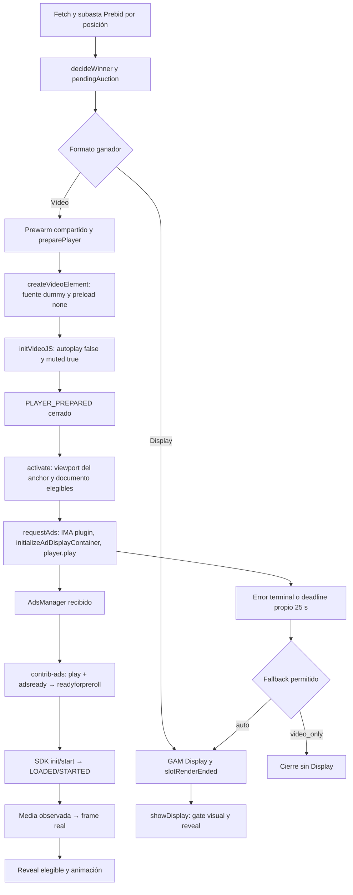

# P1.3 — Auditoría de bloqueo de vídeo (13/10/2026)

## Resultado y límite de evidencia

La causa de la espera de Display sí está demostrada en el código y reproducida
con el método real y SDK simulado: el waterfall espera el resultado de vídeo;
AdsManager adquirido sin reproducción ni evento terminal no resuelve/rechaza
requestAds(). El deadline propio de 25 s termina esa espera. AD_ERROR 303 sí
rechaza inmediatamente y permite el fallback autorizado. No se ha demostrado
todavía por qué el SDK real no inicia las seis reproducciones.

No se cambia el arranque, la reproducción, el timeout ni el waterfall. Se entrega
un cambio separado, estrictamente diagnóstico, de recordReadiness() y un QA local.
Versión conservada: 2026.10.07-p1-ima-preload-first-frame. Sin commit/push.

Los recuentos 7/8 winners vídeo, 0/7 frames/reveals, seis timeouts, un 303,
1,2 s winner→prepared, 5,7 s prepared→activation, ~1 s Display y ~0,9 s fallback
son evidencia comunicada por la revisión independiente del usuario. No se han
recalculado: las ocho capturas del 13/10 y sus HAR/SAZ no están en el workspace
localizado. Los YAML de revision contienen casos anteriores, incluidos mayo;
no se utilizan como sustitutos del 13/10. Se solicitó la ruta de los nuevos datos.
Tampoco se afirma haber contrastado los éxitos del 08/10 con los fallos actuales.

Baseline real ejecutado antes del cambio: 1017/1017 PASS.

## Flujo de código actual auditado

La parte M→C→S es el contrato del plugin que debe observarse en QA, no una
secuencia ya demostrada en los seis fallos. El plugin descargado en runtime es
videojs-ima 1.11.0; no se pudo recuperar su fuente exacta en este entorno.

- runPrebidPhase/executePrebid configuran mediaTypes según modo efectivo,
  incluyen vídeo instream/outstream según perfil y hacen una subasta; no cambian
  en P1.3. decideWinner filtra por auctionId, conserva estrategia fresh/reuse,
  ordena pujas por CPM y aplica las reglas de selección existentes.
- _requestVideo realiza TAM cuando corresponde, construye el tag GAM y llama
  buildAndPlayVideo. video_request_started representa el inicio de ese pipeline,
  no el envío HTTP efectivo de IMA. ads-request es el hito de envío observable.
- buildGAMVideoTagUrl conserva network/adUnit resueltos, targeting por posición,
  hb_* de los bids actuales, TAM, random, correlator, consentimiento heredado y
  parámetros de vídeo. No se altera ninguna URL ni targeting productivo.
- getIntextVideoBidDiagnostics recoge videoCacheKey/cacheId/vastCacheKey,
  hb_uuid/hb_cache_id/host/path y señales de targeting. Tener una señal, incluso
  un host, no demuestra que exista VAST recuperable en caché ni que siga vigente.
  El éxito de la subasta tampoco demuestra que GAM haya elegido esa creatividad.
- La antigüedad del cache de bids y pendingAuction es una política local distinta
  del TTL del objeto VAST en Prebid Cache. Hace falta correlacionar responseTimestamp,
  ttl, UUID y la respuesta HTTP de caché observada dentro de la cadena real.
  No se añade un GET de caché paralelo ni se reimplementa la expiración.
- preparePlayer asegura dependencias, crea la fuente dummy/Video.js/listeners,
  mantiene la superficie cerrada y no inicializa IMA ni hace play.
- activate espera elegibilidad del anchor/documento y libera capacidad preparada;
  el ownership/leases P1.1 y la recuperación P1.2b se mantienen idénticos.
- requestAds inicia el deadline, instala listeners, entra en player.ready,
  configura enablePreloading=true por defecto (opt-out existente),
  autoPlayAdBreaks=true y VPAID INSECURE; inicializa IMA y hace un player.play().
  Se conservan timeout/prerollTimeout/postrollTimeout=30000 y deadline=25000.
- ads-manager solo registra adquisición. No es LOADED, STARTED, frame ni fill.
  El rechazo de player.play() se diagnostica pero no provoca fallback por sí solo,
  porque IMA/contrib-ads pueden interceptar el playback de contenido.
- Reveal necesita frame real y gates vigentes. Un medio pausado, token obsoleto,
  terminal o posición fuera del viewport no puede revelar. PiP/animación intactos.
- showDisplay espera apertura visual después de recibir/renderizar GAM; no se
  adelanta ni se bloquea ahora su petición. El fallback empieza tras liquidar
  vídeo y mantiene la única superficie/loader de recuperación existentes.
- PSP/dualMode y GAM tradicional cambian las resoluciones de APIs/identidad y
  configuración aguas arriba; el creative es común. No hay evidencia que permita
  atribuir este bloqueo a PSP ni modificarlo. Deben compararse tags/config y
  dependencia realmente disponible, no solo el nombre de la ruta.

## Hipótesis priorizadas y prueba discriminante

| Prioridad | Categoría | Evidencia / límite | Prueba mínima |
|---|---|---|---|
| 1 | AdsManager obtenido pero arranque contrib-ads/SDK no ejecutado | Video.js/fuente se crean en prepare; IMA se inicializa después del gate. Contrib-ads advierte de inicialización tardía y loadstart perdido. No hay confirmación runtime exacta 1.11.0. | A con tiempo de standby corto/largo: capturar loadstart antes del plugin, play, adsready, readyforpreroll y manager.init/start; inspeccionar estado contrib-ads. |
| 2 | Dimensiones/visibilidad y posible dependencia circular | Wrapper cerrado hasta frame; readiness usa anchor distinto. Player configurado 640×360 no prueba tamaño DOM ni AdDisplayContainer. | Misma A y mismo lifecycle en collapsed, display-none y sized-hidden; guardar dimensiones reales al request/init/start. sized-hidden es exclusivamente un control QA. |
| 3 | Autoplay / estado dummy de contenido | Muted/playsinline no garantizan permisos. Error code 4 de fuente dummy se ignora; play rechazado puede ser intercept normal. | A programática y gesto de usuario, desktop/mobile; comparar NotAllowedError, play real y start. AbortError aislado no prueba causalidad. |
| 4 | Caché Prebid / wrapper / demanda | Winner positivo y UUID no prueban cache accesible; AdsManager tampoco prueba anuncio listo. | B/C en inventario QA, HAR con contenido: GAM→wrappers→cache→media, status/tiempos/cuerpo y TTL del bid. |
| 5 | Pausa/reanudación P1.2 | Pausa explícita solo fuera de elegibilidad, con control e identidad. No hay prueba de intervención en los fallos descritos. | Relacionar pausa/control/epoch con adsready/start y salidas reales; A mantener viewport frente a salir/reentrar. |
| 6 | Terminal perdido / estado sin demanda no liquidado | adserror, AD_ERROR, adtimeout y completions rechazan; nopreroll solo loguea. No se ha observado nopreroll en las capturas suministradas verbalmente. | Capturar nopreroll/error del loader y eventos terminales del SDK; determinar su semántica exacta antes de cambiar settlement. |

Existe una interdependencia potencial en la ruta cerrada: si el SDK/creatividad
requiere geometría renderizable para iniciar, pero abrir requiere first-frame,
podría bloquearse. No se considera demostrada por un wrapper de altura cero:
un hijo puede tener geometría válida aunque esté recortado. Hay que medir player,
container IMA y vídeo real, incluidos display/opacity de ancestros.

Otra limitación a comprobar en mobile es custom playback compartido: el selector
actual excluye el vídeo dummy/base al buscar media de anuncio. No explica por sí
solo la ausencia previa de LOADED/STARTED también en desktop. No se corrige sin
prueba real y sin preservar la autoridad de first-frame.

enablePreloading no equivale a start, no fuerza una impresión y no demuestra
incompatibilidad con autoPlayAdBreaks/VPAID. Comparar media linear y VPAID por
separado; no deshabilitar ambos parámetros como arreglo preventivo. Los samples
VPAID y redirect de Google pueden servir de controles adicionales manuales, no
se ejecutan automáticamente ni se añade una request.

## Cronologías disponibles

No se inventan timestamps de las ocho capturas ni se suman medianas para crear
un caso representativo. Las siguientes son secuencias comunicadas/modeladas:

| Caso | Secuencia | Tiempo fiable disponible |
|---|---|---|
| Seis fallos reportados | winner→prepared→elegible→ads-request→AdsManager→sin LOADED/STARTED→timeout→Display | 25 s desde requestAds; luego ~0,9 s request→respuesta Display, según revisión. No implica reveal a +25,9 s. |
| 303 reportado | winner→request→AD_ERROR 303→fallback Display | Rechazo inmediato en código; no hay duración individual verificable del capture. |
| Slot 2 Display reportado | request GAM→creative listo→reveal elegible | ~1 s desde request comunicado; apertura condicionada por viewport. |
| Control unitario ejecutado | manager a t=0, cerrado a t=24999, rechazo a t=25000 | Reloj falso y método real; prueba de settlement, no latencia de red. |

Ganador→prepared mediana 1,2 s y prepared→activation mediana 5,7 s son etapas
distintas. La segunda incluye scroll/elegibilidad y no se atribuye automáticamente
a CPU/IMA. No hay comparativa de reducción antes/después: reproducción y tiempos
no han cambiado. Solo mejora la atribución diagnóstica.

## QA local preparado, sin producción

Arrancar `node tests/qa/intext-p13-server.cjs` y abrir http://127.0.0.1:8133/.
El servidor escucha solo loopback y sirve un allowlist; no hace proxy/fetch de
anuncios. El navegador extrae las clases Creative/Container actuales del bundle
seleccionado sin ejecutar bootstrap Intext, Prebid, GPT, PSP ni TAM. Usa el método
real de elegibilidad y las APIs reales Video.js/IMA, con adaptador QA para node.
La animación es un hook diagnóstico y PiP no se ejecuta: este harness no acredita
la integración completa de la página ni sustituye los tests existentes.

1. A: sample Single Inline Linear de Google. Es un tag oficial, no un XML ya
   descargado o una garantía de respuesta válida hoy. Preparar sin publicidad,
   luego activar con el anchor elegible. También existe autorun=1 programático.
2. B: pegar el tag real de inventario QA autorizado y marcar la confirmación.
   Se conserva íntegro, incluido correlator/targeting. No pegar un tag productivo
   vencido y utilizar su resultado como prueba de caché actual.
3. C-with/C-without: ejecuciones separadas del mismo tag QA; solo la segunda
   elimina hb_* en la copia local. Resto de claves conservado. No modifica bids,
   auctions ni tags de producción. GAM puede devolver otra demanda: no es una
   comparación de la misma creatividad ni una prueba aislada de Prebid Cache.

Cada ejecución crea un creative/player, delega requestAds sin llamadas adicionales
a requestAds/start/play, y permite destroy explícito. El probe registra eventos
capturados loadstart/metadata/media, play llamado/resuelto/rechazado, ads-request,
ads-manager, adsready, readyforpreroll, ads-load, adstart/adplaying/terminal,
LOADED/STARTED/AD_ERROR/IMPRESSION/complete y llamadas manager.init/start/pause/
resume/resize/destroy mediante wrappers que devuelven exactamente el resultado
original. Getters/estado/rectangles se leen; no se fuerzan controles del SDK.
Incluye visibility, user activation, autoplay/muted/playsinline, readyState,
networkState, currentTime, error, vídeo real y rects anchor/wrapper/player/IMA.

DevTools Network: Preserve log + export HAR con contenido en cada ejecución.
No se solicita nuevamente el VAST para leer wrappers. Importar HAR en el QA
produce una cronología offline de status, timings, cuerpos observados y enlaces
de wrapper, también para requests de iframe que Resource Timing no explica.
El parser es diagnóstico de markup, no validador VAST. Cuerpos ausentes no se
clasifican como no-fill; XML malformado requiere parser/SDK y VAST Inspector.
Queries privadas se omiten en el resumen; conservar HAR original bajo acceso QA.

Matriz mínima: A/B/C en desktop y mobile emulado, ambas distribuciones; A standby
0/6/20 s y salida/reentrada; collapsed/display-none/sized-hidden; luego mobile
real iOS/Android. Mantener una sola ejecución simultánea por tab y destruir entre
controles. Comparar sesiones con SDK/dependencias frías y ya cargadas.

Ejecución en este entorno: el HTTP loopback devolvió 200; scripts QA y extracción
unitaria pasan sintaxis/tests. El lanzamiento headless de Edge fue rechazado por
policy. Playwright/Puppeteer no están instalados. curl falló con proxy
127.0.0.1:443 inaccesible y PowerShell falló al descargar dependencias por TLS.
No se eluden restricciones. A/B/C reales, HAR, desktop/mobile/gesto e impresiones
siguen PENDIENTES, no PASS. No hubo tráfico GAM real de estas pruebas.

## Corrección diagnóstica separada y alcance

recordReadiness enviaba state.intersectionRatio del anchor como intersectionRatio;
el collector lo combinaba con wrapperRect del wrapper, que puede estar cerrado.
Se reproduce anchor 640×24 visible (ratio 1) con wrapper 640×0 (ratio DOM 0).
Ahora se envían readinessIntersectionRatio y readinessAnchorRect. El collector
calcula wrapperRect/intersectionRatio/wrapperIntersectionRatio del wrapper real.
GAM/Active View conserva su señal separada; no se convierten ratios del anchor en
viewability publicitaria. Geometría ausente/throwing queda null sin afectar flujo.

Único método productivo cambiado: recordReadiness(), idéntico en ambos bundles.
La auditoría byte a byte contra el inicio P1.3 conserva todo el resto, incluidos
prepare/activate/requestAds/observeActivationEligibility, Floor Authority, PSP,
GAMExp, WindowArray, random, Prebid/APS/TAM, targeting, 1x1, sentinels/house/blanks,
PiP, first-frame, animación, loaders/fallback/refresh y todos los timeouts.
El patch de revisión está en intext-p13-readiness-diagnostics.patch.

## Latencia: propuestas condicionadas, no implementadas

- Liquidar inmediatamente errores terminales inequívocos ya funciona para 303/
  adserror/contrib timeout; no se reduce el deadline. Un evento nopreroll o error
  de loader perdido solo puede recibir settlement después de validar su contrato.
- Medir por etapas: ads-request→primera respuesta; respuesta→AdsManager;
  AdsManager→init/start; start→LOADED/STARTED; STARTED→frame; frame→reveal. Evitar
  confundir ADS_MANAGER_LOADED con anuncios/media listos o ausencia de señal con
  prueba de irrecuperabilidad.
- No se propone un número nuevo de timeout. Primero obtener distribuciones por
  formato/SDK/device con wrappers lentos legítimos y VPAID, exclusión de documento
  oculto/pausa consentida y censura por deadline. Un watchdog no puede cortar una
  creatividad válida solo por no haber alcanzado STARTED todavía.
- Si se demuestra loadstart perdido, separar inicialización mínima segura de
  contrib-ads de request IMA sería candidato; probar que no dispara requests ni
  reproduce durante prepare antes de tocar producción. No invocar initPrice,
  manager.start manual ni duplicar player.play como remedio.
- Adelantar VAST tras winner sigue siendo propuesta de otra revisión: puede
  cambiar accounting/eligibilidad/tráfico, caducar bids y wrappers o ejecutar
  código/tracking VPAID. No se implementa ni se promete preload sin impresión.
- Fallback auto y Display refresh después de vídeo deben validar exactamente el
  lifecycle actual; no se cambia selección, prioridad ni preload de Display.

## Fuentes oficiales consultadas

- Contrib-ads, contrato de inicialización y play/adsready/readyforpreroll:
  https://videojs.github.io/videojs-contrib-ads/integrator/getting-started.html
- Google sample tags y VAST Inspector:
  https://developers.google.com/interactive-media-ads/docs/sdks/html5/client-side/tags
  https://googleads.github.io/googleads-ima-html5/vsi/
- Google videojs-ima README (autoplay/mobile y configuración):
  https://github.com/googleads/videojs-ima
- Fuente upstream actual de referencia, NO evidencia de versión 1.11.0 exacta:
  https://raw.githubusercontent.com/googleads/videojs-ima/main/src/client-side/sdk-impl.js
  https://raw.githubusercontent.com/googleads/videojs-ima/main/src/client-side/player-wrapper.js

## Datos necesarios para cerrar causa raíz

Los ocho dumps originales con IDs/cycle/token y HAR/SAZ con respuestas, versión
efectivamente cargada del plugin, logs contrib-ads y llamadas SDK de A. Después
repetir Marca/El Mundo/Expansión desktop/mobile y separar request GAM/viewport/
viewability. Sin eso no se afirma ni descarta una regresión ni mejora real.

## Validación ejecutada

| Suite | Resultado |
|---|---:|
| Baseline antes de cambios | 1017/1017 |
| Nueva auditoría P1.3 | 13/13 |
| Vídeo/readiness/preload/PiP/animación/debugger | 437/437 |
| Floor Authority | 86/86 |
| Prebid audit + aliases | 85/85 |
| Random/runtime | 61/61 |
| APS/TAM | 63/63 |
| GPT/PSP | 17/17 |
| Suite completa | 1030/1030 |

Todos con cero fail/skipped/cancelled/todo. No se reduce cobertura anterior.
node --check: _gam_kv_.js, IntextManager.js, app QA, controls QA y server QA PASS.
git diff --check y git apply --reverse --check del patch incremental: PASS.
La auditoría byte a byte contra copias iniciales conserva todo fuera de
recordReadiness() y verifica paridad exacta de ese método.

Comandos: `node --test --test-isolation=none tests/intext-p13-video-blocking.audit.test.cjs`
y suite completa `node --test --test-isolation=none tests/*.test.cjs`.
Grupo afectado: P1.3 + intext-predictive-readiness.audit.test.cjs,
intext-ima-preload-first-frame.audit.test.cjs, intext-pip.audit.test.cjs,
intext-initial-open-animation.audit.test.cjs e intext-debugger.audit.test.cjs.
Grupos complementarios: intext-floor-authority; intext-prebid-floor +
intext-prebid-aliases; intext-random-runtime; intext-aps-display-slot +
intext-prebid-aps-psp; intext-gpt-psp + intext-gpt-controls (todos .audit.test.cjs).

Para los subprocesses execFileSync restringidos se mantiene el preload temporal
del proyecto: solo rev-parse, diff --name-only y --check reproducen resultados
ejecutados externamente por PowerShell y verificados contra SHA-256 de los inputs
actuales; ningún otro comando ni test se sustituye. El resto de la suite corre
realmente. No hay lint independiente configurado; los checks de arquitectura y
seguridad/diagnósticos disponibles se ejecutan dentro de la suite completa.

Archivos de esta iteración: dos bundles (solo recordReadiness),
tests/intext-p13-video-blocking.audit.test.cjs, tests/qa/intext-p13-controls.cjs,
tests/qa/intext-p13.html, tests/qa/intext-p13-app.js,
tests/qa/intext-p13-server.cjs, este informe y el patch diagnóstico.
Los cambios sin commit de fases anteriores permanecen intactos.

CodeMemory consultado antes de la auditoría y reindexado al finalizar:
status=indexed, 17835 nodos / 33810 aristas, persistence=false. El snippet de
recordReadiness lee los campos nuevos, pero conserva un rango estructural antiguo
(23 líneas) y trunca el final. El código actual, el diff y los tests son la fuente
de verdad; el index no se utiliza para certificar scope ni causalidad.
