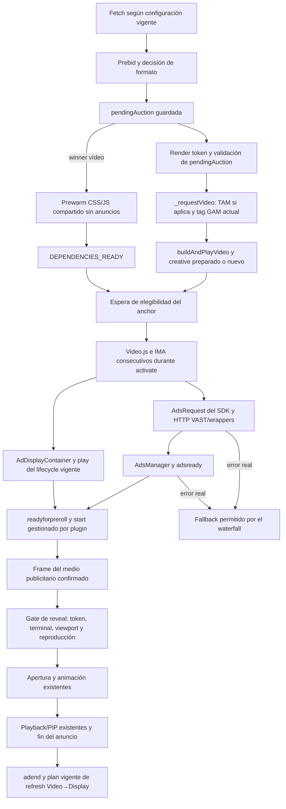

# P1.4 — Diseño de latencia y viewability mobile

**Estado: A1 solo QA; recopilación descriptiva A2 completa, 2/2 E0 Legacy auténticos.** Actualización: **26/10/2026, tras Performance**. Dos PSP E0 adicionales permanecen aparte. La atribución causal de outliers sigue abierta; A3 bloqueada. Véanse [implementación E0/E1](intext-p14a-qa.md), [informe causal A2](intext-p14a2-pre-vast-environment.md), [auditoría AdsRequest/IMA](intext-p14a2-adsrequest-ima-audit.md), [red y medios E0](intext-p14a2-e0-network-media-audit.md), [guía QA sin nuevas capturas](intext-p14a2-fiddler.md) y [matriz de evidencias](intext-p14a2-evidence-matrix.md). B/C/enforce inactivos. P1.3c visual abierta; sin aprobación de producción.

**Continuación documental B, 26/10:** el usuario acepta cerrar la recopilación A2, manteniendo H-IMA/H-QA abiertas y A3 bloqueada. Se entrega la [especificación técnica offline B shadow](intext-p14b-shadow-design.md), con [matriz de observabilidad](intext-p14b-shadow-observability-matrix.md) y [contrato QA propuesto](intext-p14b-shadow-qa-contract.md). B sigue **sin implementar ni activar**. El siguiente paso es revisión independiente y aprobación explícita antes de cualquier implementación; esta tarea termina al entregar los documentos, sin nuevas capturas.

**Revisión independiente B, correcciones r2 del 27/10:** arquitectura aceptada; implementación QA **todavía no autorizada**. Primera etapa futura limitada a B0–B3 por snapshot: B0 refleja C0 sin P; B1–B3 exigen modelo de calidad mínima. B4/B5 quedan documentados/diferidos, unknown sin cobertura y fuera de evaluación inicial, sin nuevos listeners/observers/polling/timers. Contabilidad D0/Dv/Dc separada del ring; si la población/numerador no son completos, se prohíben tasas exactas. Calidad P y protocolo de coste total concretados en los tres documentos B; tabla R1–R6 en el diseño. Detenerse para segunda revisión independiente; sin implementación, tests ejecutables ni nuevas capturas.

## 1. Recomendación y límites

Recomiendo una secuencia de menor a mayor riesgo:

1. Mantener el cierre visual P1.3c como gate independiente y fijar una baseline verificable con el mismo dummy y la misma instrumentación en cada brazo. El ensayo QA P1.4-A autorizado no cierra ese gate.
2. Ensayar optimización de **dependencias compartidas después del winner vídeo**, manteniendo intactos activación, petición publicitaria y reproducción. Evaluar solapar la descarga de IMA con la cadena Video.js/contrib-ads, respetando sus dependencias de ejecución. No crear players durante prepare.
3. Medir un gate de activación basado en la **posición prevista de la superficie publicitaria**, visibilidad del documento y movimiento reciente. Primero calcularlo offline, sin alterar el gate vigente. Solo después de evaluar oportunidades perdidas, proponer un ensayo QA separado de ese gate.
4. Mantener como investigación independiente la separación request/preparación IMA → inicio. El SDK tiene APIs públicas, pero no está demostrada una ruta compatible del plugin 1.11.0 con nuestro VAST simple que retenga el único inicio sin romper contrib-ads. No adoptar AD_BREAK_READY, el gate C anterior ni un start alternativo por suposición.

La optimización de dependencias puede reducir una parte de la latencia. Un gate previo puede reducir el riesgo de iniciar tras un scroll rápido. **Ninguna de las dos garantiza cero STARTED/IMPRESSION fuera del viewport** durante una respuesta publicitaria asíncrona. Si esa garantía es un requisito absoluto, hace falta demostrar un contrato válido de control del inicio; hasta entonces no hay base para prometerla.

No se cambia monetización, prioridades GAM, floors, targeting, timeout, random, fallback o refresh. No hay deadlines, cancelaciones nuevas, llamadas sintéticas de play/start ni enforce. No hay commit, push o despliegue.

## 2. Fuentes, alcance y fuerza de la evidencia

- Código actual de `_gam_kv_.js` e `IntextManager.js`, contrastado después de consultar CodeMemory. Las descripciones antiguas de Predictive Readiness no prevalecen sobre P1.3b: actualmente prepare solo calienta dependencias.
- [Seis debugger/HAR del 20/10 y hashes de entrada](intext-p13c-integration-evidence.json): dos originales y cuatro con dummy negro. Son observaciones reales mediante Fiddler, no un experimento aleatorizado que aísle red, scroll o caché. Los seis contextos son PSP/dual, con random de targeting nativo.
- [Investigación R2 del 19/10](intext-p13c-r2-analysis.md) y [evidencia R2](intext-p13c-r2-evidence.json): siete sesiones observe/shadow, sin PSP. Se usa su Mobile shadow2 como caso histórico separado, no como otra sesión del 20/10.
- [Revisión de integración](intext-p13c-integration-review.md), [manifest QA](intext-p13c-integration-build.json) y [guía Fiddler](intext-p13c-integration-fiddler.md). La captura real de Marca mobile del 21/10 comunicada en la revisión confirma cobertura nativa IMA, COMPLETE, restauración del dummy negro y destroy posterior; el cierre visual continúa pendiente. Esta actualización conserva los valores comunicados y no representa otra ejecución de navegador.
- Documentación primaria de Google y Prebid, consultada para este diseño y enlazada junto a las afirmaciones correspondientes. La documentación actual del SDK no prueba que una característica funcione con el tag real, el navegador y el plugin fijado.
- Revisión íntegra de Descargas `Informe_P14A2_revision_HAR_completos_2026-10-22.md`, contrastada offline con seis HAR completos, seis debuggers y seis exports QA: **seis E1 reales**, incluidos tres nombres E0, Legacy sin PSP. Se registran como cohorte adicional `P14A2-Legacy-E1-20261022-full-HAR`, separada del estudio anterior 4 E0 + 6 E1 PSP/dual. [Hashes e hitos nuevos](intext-p14a2-har-complete-evidence.json). Cinco COMPLETE, un timeout a 25,02 s sin VAST ni manager observados y esperas pre-VAST de hasta 21,232 s; no son controles E0 ni un A/B nuevo.
- Revisión íntegra `Informe_P14A2_E0_reales_25-26_octubre_2026.md` y sus nueve originales: los nombres A2-Legacy-E0-real-1/2 corresponden a **dos PSP E0 del 26/10**; A2-PSP-E0-1 es **un Legacy E0 del 25/10**. Hash/assignment_fixed/loader secuencial verifican E0 en los tres, todos COMPLETE. Se registran como dos grupos nuevos, separados de los anteriores. [Evidencia y hashes](intext-p14a2-e0-real-evidence.json). Bridge 3.795.0 y fechas/contextos distintos impiden una comparación causal con el 22/10.
- Revisión íntegra `Informe_P14A2_E0_Legacy_Performance_2026-10-26.md` y cuatro originales: **Legacy-E0-2**, arm/hash/contexto verificados, COMPLETE, bridge **3.796.0**, sin outlier reproducido. [Evidencia nueva](intext-p14a2-legacy-performance-evidence.json). Cumple el segundo control descriptivo; no es un A/B ni control histórico sin coordinador. Trace GZIP ~35,79 s, posterior a dependencies/prepare; screenshots ~14,23 s iniciales, anteriores a COMPLETE. No cierra P1.3c visual.

El HAR de negro4 está truncado: solo se usan sus 516 entradas completas. Las cinco respuestas principales GAM VAST recuperadas tienen HTTP 200, pero no cuerpo XML. No se conocen todas las cadenas de wrappers ni se atribuyen MP4 de otros proveedores de la página al Intext.

## 3. Flujo actual y autoridades

Hay dos decisiones distintas: Intext elige **formato/ruta** con el waterfall vigente; GAM resuelve posteriormente la **creatividad/line item** a partir del tag real. Un bid vídeo ganador en Prebid no demuestra que GAM haya servido ese bidder. La campaña fija Sponsorship puede ser la creatividad final. No se modifica ninguna de esas decisiones.

Los callbacks nativos y de media pueden llegar en distinto orden: el diagrama expresa dependencias, no garantiza que el log nativo STARTED preceda al callback de frame ni impone un orden entre AdsRequest y la llamada de play del core. Se correlacionan identidades y estado, no solo nombres de eventos.

| Punto del core actual | Papel / límite |
|---|---|
| `IntextWaterfall.startFetch`, `_gam_kv_.js:13046` | Prebid → decisión → pendingAuction; inicia prewarm no bloqueante solo para winner vídeo; fetchComplete no espera a los scripts |
| `setupVideoPreparation`, `:12735` | Proximidad/scheduler y ownership de cada posición; prepare actual no crea Video.js ni IMA |
| `startRender`, `:13149` | Claim del token y comprobación de expiración configurada de pendingAuction; libera la ruta ganadora |
| `buildAndPlayVideo`, `:11978` | Recupera creative preparado; si falta, espera `capacity-or-legacy`. Después de prepare vuelve a comprobar viewport antes de render |
| `_requestVideo`, `:14863` | TAM vídeo si está configurado; construye tag GAM antes de esperar el playback. No es sinónimo de HTTP VAST |
| `buildGAMVideoTagUrl`, `:15690` | Red/adUnit/contexto reales y HB vídeo; no usa el bid para sustituir la decisión final de GAM |
| `preparePlayer`, `:16638` | Espera `ensureDependencies`; emite prepared con `playerCreated:false` |
| `activate`, `:16692` | Valida token/elegibilidad, crea player y después inicializa el plugin en requestAds; no resucita instancias de otro ciclo |
| `getReadinessViewportState`, `:11488` | Solapamiento X/Y de anchor con tamaño, CSS y documento válidos; basta cualquier solapamiento positivo. No mide viewability del anuncio |
| `observeActivationEligibility`, `:16710` | Antes del reveal pausa/recupera con ownership IMA/media y guards P1.2b; después del reveal deja actuar al lifecycle/PiP existente |
| `requestAds`, `:17381` | IMA automático, first-frame, reveal y errores; la respuesta/publicidad no espera a que el wrapper haya terminado de abrir |

La autoridad de consentimiento sigue siendo la integración vigente. La geometría no sustituye consentimiento, permisos de autoplay ni controles del SDK. El resultado de play se observa; no se añaden intentos de play para detectar capacidades. La guía oficial describe restricciones de autoplay y playsinline, pero eso no autoriza a cambiar la UX o las señales del request en este P1.4. [Google: autoplay](https://developers.google.com/interactive-media-ads/docs/sdks/html5/client-side/autoplay).

Hay varias comprobaciones de elegibilidad: la ruta capacity-or-legacy si no hay standby, la espera de buildAndPlayVideo después de prepare y el guard final de activate/plugin/ready. No son tres timeouts fijos ni hay evidencia de que cada comprobación añada segundos. Se instrumentan sus intervalos sin eliminarlas. El prewarm de fetch continúa siendo independiente de esas esperas.

## 4. Costes comprobados y costes todavía no atribuibles

### 4.1 Duraciones por sesión

Milisegundos; Slot 1/ciclo inicial. Se deduplican los logs equivalentes del collector. `prepared` significa dependencias listas, no anuncio listo. El proxy ads-request no es un timestamp de inicio HTTP. Son sesiones individuales, no percentiles de tráfico.

| Sesión 20/10 | Prewarm | Winner→prepared | Prepared→activate | Activate→proxy | Proxy→manager | Manager→frame | Activate→frame | Frame→reveal |
|---|---:|---:|---:|---:|---:|---:|---:|---:|
| Original1 | 8517 | 8602 | 78 | 287 | 10485 | 1076 | 11848 | 8526 |
| Original2 | 11423 | 11497 | 72 | 130 | 3433 | 887 | 4450 | 14402 |
| Negro1 | 6895 | 6953 | 74 | 274 | 6728 | 603 | 7605 | 9 |
| Negro2 | fallo | fallo | — | — | — | — | — | — |
| Negro3 | 2130 | 2203 | 8052 | 132 | 1466 | 954 | 2552 | 4 |
| Negro4 | 3061 | 3186 | 75 | 166 | 4880 | 747 | 5793 | 6 |

Interpretación causal limitada:

- **Infraestructura:** prewarm observado de 2,130–11,423 s en los cinco éxitos. Ya se lanza tras winner; ampliarlo en código al mismo punto no aporta una optimización nueva. Solo cuenta en el camino crítico la parte que no se solapa con aproximación/render.
- **Elegibilidad:** negro3 tiene 8,052 s prepared→activate. No son descarga de vídeo ni lentitud de GAM. Ese intervalo incluye la espera del lifecycle/usuario; para atribuirlo enteramente a viewport hacen falta sus hitos de render y controles intermedios.
- **Inicialización:** activate→proxy de 130–287 ms es un intervalo compuesto, no una medición aislada de CPU Video.js/IMA. `_playerBuildStartedAt` comienza antes de `video_activation_started`; ambos relojes no se intercambian. El probe actualizado permite separar attach después de Video.js y retorno de IMA (`core:video-player-prepared`), pero no tenemos todavía esa captura nueva.
- **Respuesta publicitaria:** proxy→manager varía de 1,466–10,485 s e incluye SDK/red/wrappers/colas. No es TTFB de GAM.
- **Arranque:** manager→frame de 603–1076 ms incluye contrib-ads, inicio SDK, selección/transferencia/decodificación del media y scheduling. No todo es tiempo de decoder ni de start.
- **Apertura:** frame→reveal es 4–9 ms en los tres éxitos negros; eso mide solicitud de reveal, no fin de animación ni primer píxel visible. Los originales esperan 8,526/14,402 s, compatibles con el gate/reentrada registrados; no se atribuyen al dummy ni a rendimiento de decode por comparación entre sesiones distintas.

`winner→visible` no se calcula sumando prewarm y winner→prepared, que se solapan. La descomposición correcta usa hitos consecutivos y conserva waits concurrentes como intervalos. Un éxito después de reentrada no cuenta como éxito en la primera pasada.

### 4.2 Baseline separada del 21/10/2026

Captura real de Marca mobile comunicada por el revisor, con el probe de integración y dummy negro QA. No se agrega a las seis sesiones del 20/10 ni se utiliza como resultado de P1.4-A.

| Medida 21/10 | Resultado |
|---|---:|
| Prewarm | 3139 ms |
| Espera residual de dependencias | 2589 ms |
| Activación → primer frame | 3454 ms |
| Cobertura nativa IMA | Observada |
| COMPLETE → restauración de dummy negro → destroy | Observado |
| Ausencia visual de contenido base / siguiente ciclo | Pendiente de cierre P1.3c |

Prewarm y espera residual se solapan: no sumar 3139 + 2589 ms como latencia total. Tampoco atribuir 3454 ms a red, CPU o IMA aisladamente. No se dispone aquí de una descomposición HAR/Performance nueva de esta sesión. La restauración y destroy observados no prueban por sí solos que el contenido base nunca fuese visible. No hay muestra estadística ni beneficio E0/E1 demostrado.

### 4.3 HAR y el fallo de infraestructura del 20/10

| Sesión | Proxy→inicio HTTP GAM | VAST HTTP total | blocked | wait |
|---|---:|---:|---:|---:|
| Original1 | 6856 | 3459 | 372 | 140 |
| Original2 | 3114 | 199 | 19 | 178 |
| Negro1 | 4421 | 646 | 168 | 224 |
| Negro3 | 1108 | 293 | 9 | 145 |
| Negro4 | 4527 | 276 | 12 | 150 |

Hay un tramo importante anterior al HTTP GAM. Es un hueco de atribución, no una demostración de un fallo de GAM. El SDK descarga infraestructura adicional durante activación; además pueden intervenir ejecución y scheduling del navegador/Fiddler. Harían falta Performance/initiator y respuestas completas para separarlo. `blocked` es clasificación del navegador, no tiempo del servidor; SSL puede estar incluido en connect y no debe sumarse dos veces.

Negro2: `video_dependency_script_timeout` a t=17.735, dependencia contrib-ads, elapsed=10.001 ms. El HAR de ese JS: total 11.096 ms, blocked 10.276 ms, wait 819 ms. No hubo activación IMA ni AdsManager. Es evidencia de límite del **loader Intext**, no del preroll interno ni de falta de demanda. No se cambia el límite de scripts de 10 s, el timeout publicitario de 25 s ni las opciones actuales de 30 s del plugin.

Su fallback ilustra la separación correcta: error 17.735 → fallback solicitado 17.761 → notificación GPT 18.413 → slotRenderEnded 20.984 → wrapper abierto 21.024. La espera viewport 20.998→21.000 fue pequeña; la mayor parte posterior a request fue respuesta/render Display. El refresh de 29.245 es otro ciclo. No se utiliza un refresh posterior para medir el fallback inicial.

## 5. Por qué STARTED o IMPRESSION pueden preceder a una superficie perceptible

**Nuevo caso 26/10:** tras **5909 ms** de espera viewport, el anchor se acepta con apenas **0,225%** de intersección (top~921,663 en viewport 922); la superficie prevista está en top~1091,662, fuera, y el wrapper cerrado. Ads-request encuentra ~3,43% y manager/frame ratio 1 tras scroll: no demuestra start fuera. Confirma la pregunta B shadow sobre anchor frente a región prevista; no fija un umbral óptimo ni autoriza activar otro gate. `residualDependenciesWaitMs=0` coexiste con winner→frame 11233 ms y activación→frame 3504 ms.

Performance añade evaluación bridge 409 ms con compilación 285 ms **dentro** de tarea 536 ms, GC principal ~165 ms y transporte GVT 302 ~1012→206 ~280 ms. Son costes anidados/concurrentes, no fases sumables ni prueba causal de los outliers históricos. VAST HTTP 200/~255 ms sin XML; falta separación cliente/proxy/origen. La [auditoría](intext-p14a2-e0-network-media-audit.md) conserva relojes, hilos y cobertura.

### Hechos

1. El wrapper empieza cerrado hasta el frame, por contrato UX. Por tanto, un STARTED brevemente anterior a la apertura puede ser consecuencia normal del orden SDK→frame→reveal, sin que el slot esté fuera del viewport.
2. Readiness utiliza el anchor, no el rectángulo publicitario final. En Mobile shadow2 del 19/10 el anchor estaba inicialmente a top=757,66 con viewport de 760: solo ~1,56% del anchor era visible. El wrapper cerrado estaba más abajo, top=927,66. En negro3 del 20/10 se observa también anchor elegible y wrapper top=809,46, aún fuera de un viewport de 760.
3. Una vez emitida la petición, el usuario puede pasar de largo mientras se resuelve. El plugin 1.11.0, con autoPlayAdBreaks=true, inicia AdsManager desde readyforpreroll sin consultar la geometría del nodo Intext. El reveal sí la consulta. La ruta se ha contrastado con el código capturado y el [código oficial de esa versión](https://raw.githubusercontent.com/googleads/videojs-ima/v1.11.0/src/sdk-impl.js).
4. Antes de existir manager/media no hay recurso de reproducción que pausar. La reaparición de APIs y los callbacks de inicio se gestionan de forma asíncrona. La pausa reactiva no acredita un veto anterior al start.
5. STARTED expresa comienzo de reproducción; IMPRESSION informa del ping de la URL de impresión. LOADED no equivale a frame. Ninguno acredita por sí mismo que el usuario haya visto píxeles ni que se haya cumplido Active View. [Google: tipos de eventos IMA](https://developers.google.com/interactive-media-ads/docs/sdks/html5/client-side/reference/namespace/google.ima.AdEvent).

### Caso histórico discriminante: Mobile shadow2, sin PSP

Desde proxy ads-request: isInAdMode=true ya aproximadamente a +241 ms; manager a +12.446; readyforpreroll unos 5 ms después; frame a +12.998; IMPRESSION a +13.058 con anchor fuera del viewport; reveal a +18.694 tras reentrada. Activation→frame=13.174 ms. No hay HAR de esa sesión: no se atribuye su demora a HTTP, GAM o SDK. La pausa y su confirmación deben correlacionarse por manager/media/epoch; retener el reveal no evitó aquella impresión.

El estado contrib-ads inAdMode anterior al manager es un estado de su FSM, no prueba de una impresión ni de un recurso controlable. Tampoco autoriza cancelación. El deadline shadow histórico no canceló y no forma parte de esta propuesta.

### Hipótesis y datos pendientes

| Pregunta | Estado | Prueba que discrimina |
|---|---|---|
| ¿Qué parte del gap proxy→HTTP es SDK adicional, main thread o red? | Abierta | Initiator/Performance, marcas del plugin, HAR completo, caché/SDK hash y control sin probe |
| ¿El render token/media correcto recibe frame del anuncio y no base restaurada? | Hay guards y exclusión de base; cierre visual pendiente | Identidad base/tech/IMA, sourceId, snapshot/FSM, native COMPLETE/CONTENT_RESUME y vídeo de pantalla |
| ¿Los errores 1005 y el bloqueo histórico sin preroll tienen una única causa? | No demostrado | XML/wrappers, código/innerError/stack y estado normal frente al fallo; no colapsarlos en timeout genérico |
| ¿Pausar al recibir manager puede evitar todo start tardío? | No demostrado; carrera posible | Orden real de listeners/init/start/PAUSED/IMPRESSION, sin interceptar ni añadir llamadas |
| ¿Un mejor gate reduce oportunidades invisibles sin perder ingresos? | Hipótesis | A/B con denominador independiente del gate y tráfico comparable |

No se cambia la animación para que un evento parezca visible antes. Un snapshot height=0 en `video_player_revealed` puede ser el inicio de la transición, no prueba de que nunca abrió. Tampoco se exige wrapper height>0 **antes** de activar: generaría un bloqueo circular con el reveal ligado al frame.

## 6. Comparación de alternativas

| Alternativa | Cambio que se estudiaría en una fase posterior | Beneficio esperado, sin afirmar mejora real | Riesgo / limitación |
|---|---|---|---|
| A. Infraestructura compartida | Solapar descargas independientes, verificar caché/entrega de assets fijos; seguir reutilizando la Promise actual | Menor espera residual de dependencias y menos fallos por carga tardía | Bajo a moderado; CPU/red/CSP/orden de ejecución. No controla el inicio del SDK tras VAST |
| B. Gate representativo | Usar región prevista del anuncio, documento y movimiento para decidir cuándo activar por primera vez | Menos activaciones cuando solo entra un borde del anchor o el usuario está pasando de largo | Moderado; puede iniciar más tarde, perder oportunidades y envejecer bids. No elimina una carrera posterior al request |
| C. IMA preparado e inicio retenido | Únicamente mediante contrato público compatible y ownership único demostrado | Potencialmente solapar respuesta publicitaria con la aproximación y liberar un único inicio elegible | Alto y actualmente no habilitable: VAST simple, plugin/FSM, autoplay, tracking, TTL, preloading mobile y tráfico adicional |

### A. Dependencias: propuesta prioritaria

El loader actual carga JS en serie: Video.js → contrib-ads → ima3 → videojs-ima. Conserva bounded Promise, canonicalización, validación available(), deduplicación y posibilidad de retry posterior tras fallo. Estos contratos se mantienen.

Propuesta para un futuro ensayo QA: iniciar, **solo después del winner vídeo y de guardar pendingAuction**, dos ramas de infraestructura: Video.js→contrib-ads e IMA SDK; ejecutar videojs-ima cuando ambas estén listas. CSS continúa compartido; no se crean vídeo, player, AdsLoader ni request en fetch. La independencia de ejecución de las ramas debe probarse con las versiones actuales y sin globals de otra integración. La configuración alternativa de [videojs-ima 1.11.0](https://github.com/googleads/videojs-ima/blob/v1.11.0/README.md) admite el SDK antes de contrib-ads; eso no demuestra por sí solo el beneficio de red de paralelizarlo.

Si a, b, c, d son los tiempos ideales de las cuatro descargas, el límite teórico pasa de a+b+c+d a max(a+b,c)+d. Es una cota de laboratorio sin contención ni coste de evaluación; no es ahorro observado. En negro2 la rama contrib-ads bloqueada seguiría dominando: paralelizar IMA no arregla necesariamente aquel timeout.

Evaluar headers de caché, revalidaciones y reutilización por navegación real; no borrar caché comercial para fabricar diferencias. No mover/autoalojar IMA ni actualizar librerías; no añadir preload/preconnect antes del winner, prioridad alta indiscriminada, más reintentos o un coordinador global nuevo. Una consolidación de assets estáticos requeriría otra propuesta de entrega/CSP/licencias, no entra en el primer ensayo.

Se conserva scheduler por nodo y caché de scripts por página, con su validación DOM. No se preparan players para display_only ni por número de slot. Borrar un standby no debe borrar las dependencias compartidas ni revocar un render transferido.

### B. Gate: diseño que primero se calcula sin efectos

Separar **proximidad de preparación**, **elegibilidad de activación** y **elegibilidad de reveal**. fetchRootMargin, renderRootMargin y los experimentos vigentes no se reinterpretan ni se amplían. El ganador puede llegar después de entrar en cualquier margen: ningún margen garantiza una cantidad de anticipación temporal.

Entradas candidatas, leídas sin modificar DOM:

- Documento visible; anchor conectado, con tamaño y CSS renderizado válidos; solapamiento horizontal real.
- Borde de inserción/superficie cerrada y altura esperada de la misma configuración que utilizaría el core al abrir. Construir un **rectángulo previsto**, sin abrir wrapper, reservar hueco ni mostrar loader. No hardcodear el desfase observado de 170 px; depende del DOM y la posición.
- Distancia y fracción visible de ese rectángulo, y de anchor por separado. Ninguna es Active View.
- Movimiento reciente mediante eventos scroll/resize/IO ya disponibles: aproximación, salida, reentrada o señal insuficiente. Muestras limitadas a la sesión/página, sin polling, perfil de usuario, observers globales o predicción compleja.
- Token/generación, ownership y vigencia del ganador; consentimiento/autoplay conservan sus autoridades existentes.

El primer estudio compararía offline el gate actual con candidatos de fracción prevista (por ejemplo 25% y 50%, **hipótesis de calibración, no defaults**), registrando cuáles habrían adelantado/retrasado una activación y en qué dirección se movía el usuario. No elegir el umbral que maximice un porcentaje condicionado a los pocos anuncios que llegaron a reproducirse.

Un cálculo orientativo de tiempo restante en pantalla, a partir de distancia y movimiento, solo ayuda a explicar casos; con velocidad cero, cambios de dirección o pocas muestras debe ser unknown. No se convierte en deadline, timeout o cancelación. En una prueba posterior autorizada, una condición no satisfecha mantendría el recurso válido esperando reentrada según el lifecycle; no elegiría Display, haría rebid ni reabriría un ciclo terminal.

El gate debe medir la posición prevista de la superficie, no exigir tamaño real del wrapper aún cerrado. Después del frame, mantener el gate de reveal, animación y PiP existentes. Exigir más estabilidad antes de activar puede mejorar el contexto y a la vez empeorar activation tardía: es un tradeoff que se mide, no una mejora automática.

### C. Separar IMA y comienzo: contrato y bloqueo actual

La API pública distingue request, obtención de manager, init y start. `AdsManager.start()` inicia los anuncios y exige inicializar antes AdDisplayContainer; pause/resume actúan sobre anuncios ya iniciados/pausados, no son un contrato de retención antes del comienzo. [Google: AdsManager](https://developers.google.com/interactive-media-ads/docs/sdks/html5/client-side/reference/interface/google.ima.AdsManager).

El plugin 1.11.0 gestiona esa secuencia: con autoPlayAdBreaks=true, readyforpreroll lleva a initAdsManager y start. Con false inicializa manager al cargarlo y expone `setAdBreakReadyListener`/`playAdBreak`, pero el evento AD_BREAK_READY está documentado para ad rules/VMAP. No se ha demostrado ese evento en nuestro VAST simple. Por ello no basta cambiar una opción ni llamar a start desde ads-manager. No se añade una segunda autoridad sobre el plugin. [Plugin 1.11.0: control manual](https://github.com/googleads/videojs-ima/blob/v1.11.0/README.md#disable-automatic-ad-break-playback), [Google: ad rules](https://developers.google.com/interactive-media-ads/docs/sdks/html5/client-side/ad-rules).

Existe además una limitación de beneficio: según la guía IMA, el preroll VAST simple con enablePreloading se carga en init; sin preload, en start. En la ruta automática actual init/start son consecutivos: la opción no crea por sí sola segundos de anticipación. El preload de media no funciona en mobile web iOS, y VPAID no precarga su media dependiente antes de ejecutar la creatividad. Por tanto no se puede prometer una mejora uniforme mobile ni tratar preload como retención de impresión. [Google: media preload](https://developers.google.com/interactive-media-ads/docs/sdks/html5/client-side/preload). La [matriz de compatibilidad](https://developers.google.com/interactive-media-ads/docs/sdks/html5/client-side/compatibility) también advierte limitaciones del preload nativo con control manual AD_BREAK_READY. Activar ambos no acumula necesariamente sus beneficios.

Para considerar C harían falta, antes de un ensayo comercial: contrato público documentado en la integración concreta, una sola autoridad request/init/start, pruebas de VAST real autorizado y navegadores objetivo, conservación de la FSM/loadstart, evidencia de cero request/impresión antes de su gate autorizado y de cero inicio fuera de su elegibilidad, sin parches globales. También demostrar retorno/reentrada, teardown y siguiente ciclo. Si eso exige cambiar plugin/adaptador o inventario, se entrega como otro diseño; no se implementa como ajuste de P1.4 ni se adopta el gate C experimental anterior.

El timeout de seguridad actual comienza en requestAds del core. Mover esa operación a prepare consumiría el plazo mientras se espera al usuario; retrasar o rearmar el reloj cambiaría su semántica. Ninguna de esas modificaciones está autorizada por este diseño. Una inicialización técnicamente separada tendría que conservar el origen del timeout y no generar request/play/tracking antes de su gate; un prefetch VAST más temprano requeriría evaluar y autorizar aparte sus consecuencias comerciales. C queda fuera del primer A/B.

## 7. Impacto comercial y compatibilidad

Conservar el algoritmo económico no garantiza ingresos idénticos: cambiar el momento o el número de requests puede cambiar oportunidades, caducidad y campañas elegibles. Deben observarse resultados reales por oportunidad, además del CPM.

| Área | A: dependencias | B: gate | C: preparación IMA separada / requisito adicional |
|---|---|---|---|
| GAM Sponsorship | Sin cambio deliberado de tag/selección; podría evitar pérdidas por infraestructura | Menos/más tardíos requests pueden afectar entrega y share de oportunidades | Pre-request y retención pueden cambiar tráfico/medición; revisar con AdOps antes de cualquier ensayo |
| GAM Price Priority | Mismo tag, pujas y floors | Una respuesta demorada puede encontrar otro contexto temporal o bid envejecido | La creatividad final puede ser distinta; comparar line item/creative y no solo adUnit |
| Prebid vídeo / RichAudience | Ningún cambio de bidder, cache, HB ni subastas | Más espera puede superar TTL comercial/cache, aunque pendingAuction pasara su control inicial | No extender TTL ni retener una creatividad más allá de su validez; no reconstruir targeting para salvarla |
| PSP/Legacy | Misma resolución de red/contexto; vigilar SDK compartido preexistente | Mismo motor Intext, pero geometría/scroll difieren por página | No introducir dependencia de PSP ni modificar su lifecycle para controlar IMA |
| Display fallback | Solo podría cambiar incidencia de fallo de infraestructura; misma política | El momento del fallo/usuario puede desplazar la oportunidad de recuperación | Una solicitud cancelada/reenviada alteraría semántica: no propuesta aquí |
| Refresh | No duplicar ni invalidar tokens; infraestructura reutilizable | Respetar cambios de modo y leases; ningún standby expira un render owned | P1.3c debe demostrar snapshot/restore, dispose y bridge sin contenido base visible |
| Viewability e impresiones | Menos latencia no es viewability acreditada | Puede bajar inicios con anchor superado y también bajar fill/oportunidades | Solo con contrato fiable podría retener el inicio; tracking no se deduce de preload |
| PiP/animación | Intactos | Sin PiP para compensar un primer arranque tardío; reveal sigue ligado al frame | Ninguna animación anticipada ni modificación de surface para maquillar métricas |

Sponsorship sirve objetivos de participación y Price Priority compite en demanda no garantizada; no se reasignan prioridades para favorecer una variante. El entorno real puede incluir dynamic allocation, por lo que no se garantiza una creatividad solo por el tipo de línea. [GAM: tipos/prioridades](https://support.google.com/admanager/answer/177279?hl=en).

RichAudience soporta vídeo según su [ficha oficial](https://docs.prebid.org/dev-docs/bidders/richaudience.html), pero un `hb_bidder=richaudience` aislado no identifica la creatividad final de GAM. Correlacionar mediaType/auctionId/bid, cache key observada y VAST/creative nativo. La [documentación Prebid de TTL/cache](https://docs.prebid.org/dev-docs/publisher-api-reference/setConfig.html) distingue vida comercial del bid de retención en memoria: no se amplía ninguna de ellas. Tampoco se cambia ninguna opción nueva citada en esa documentación que pudiera no existir en la versión instalada.

La edad de pendingAuction se valida en startRender; la espera posterior a ese punto no debe suponerse revalidación automática de todo cache/TTL. Es un riesgo a medir al estudiar B, no una autorización para rebid, filtrar bids o cambiar targeting. Sentinels, blanks, house, Prebid 1x1 legítimo, aliases, floors y APS/TAM quedan fuera del cambio.

## 8. Medición: evitar atribución y selección engañosas

### Hitos y reloj

Usar page/navigation, slot, cycleId, renderToken, auctionId, playerId, managerId y media/sourceId locales. Conservar timestamps monotónicos dentro de la página; correlacionar HAR con reloj absoluto y anotar desfase. Los sourceId del probe saneado solo valen para una ejecución. El HAR/filmstrip se guarda por el canal restringido; no se publican URLs con tokens.

Hitos mínimos: fetch, winner, prewarm begin/end, render, prepare begin/end, primera elegibilidad **con la regla control**, comienzo de construcción real del player, attach post-Video.js/pre-IMA, retorno de IMA, ads-request proxy, VAST HTTP/wrappers, ads-manager/adsready/readyforpreroll, native STARTED/IMPRESSION, frame, reveal solicitado, geometría durante apertura, COMPLETE/adend, fallback/refresh request-render-open y dispose. Hito ausente = unknown; no usar manager como LOADED ni revelar un duration a cero para evitar null.

Registrar por separado documento visible, anchor, rectángulo previsto, wrapper real, player y medio IMA; CSS de ancestros/overlay y cambios de altura. Para coste: Resource/Network/Performance de Chrome, duración síncrona de hooks, observerBuildMs, CPU/long tasks y caché. No sumar observerBuildMs como si fuera todo el coste del probe. Comparar instrumento idéntico entre brazos y hacer controles sin probe.

### Métricas propuestas

| Métrica | Definición / cautela |
|---|---|
| Winner→dependencies ready; residual dependencies wait | Beneficio de A separado del scroll. Un prewarm más rápido que ya terminaba antes de elegibilidad puede no mejorar el frame |
| Elegibilidad control→primer frame visible | Resultado principal en primera pasada; si no hubo frame antes de salir, cuenta como oportunidad no conseguida, no se borra del análisis |
| Winner→frame y winner→reveal/visible | Informar distribución y proporción sin éxito; percentiles de éxitos solos tienen sesgo |
| Activate→proxy→HTTP→manager→preroll→frame | Descomposición técnica; HTTP, TTFB y blocked separados, wrappers reales si hay XML |
| Frame→reveal solicitado y apertura→visible | Distinguir transición/viewport de latencia publicitaria |
| STARTED/IMPRESSION con anchor/rectángulo previsto ineligible | Riesgo de anuncio iniciado fuera de oportunidad; documento oculto separado |
| STARTED mientras wrapper cerrado; tiempo de playback no perceptible | Breve cierre hasta frame es inherente al contrato actual; no confundirlo con estar fuera de pantalla durante segundos |
| Inicios por primera pasada, reentrada y missed viewport | Regreso tardío no cuenta como éxito inicial. No usar PiP como sustituto de elegibilidad de primer reveal |
| Error→fallback request→GPT→render→open | Explicar demanda, waterfall, geometría y scroll. COMPLETE→refresh es otra serie |
| Requests, fill, native impresión, COMPLETE, viewability medible | Distintos hitos; HTTP 200/adsready no es impresión o fill visible |
| Ingresos netos por mil oportunidades, por formato y total | Usar ingresos reconciliados de adserver/SSP; raw CPM o puja ganadora no son ingresos cobrados. Sponsorship requiere criterio contable de AdOps |
| CPU/red/memoria, LCP/INP/CLS, scripts duplicados y cleanup | Comprobar que acelerar infraestructura no perjudica el artículo o al segundo slot |

El primer píxel perceptible no se prueba con `revealed` ni con dos rAF. El campo DOM puede ser un **proxy de perceptibilidad** (box positivo, CSS visible y solapamiento); debe etiquetarse así. En QA contrastarlo con grabación/filmstrip y un frame realmente publicitario. La medida GAM/IMA de viewability, si existe, se guarda aparte con su cobertura. Ausencia de listener no equivale a ausencia de impresión. No hacer un canvas cross-origin o un timestamp inferido pasar por prueba visual.

Denominadores predefinidos: (a) todas las oportunidades de posición/ciclo disparadas por el fetch vigente; (b) las que alcanzan por primera vez la elegibilidad de **control**, calculada igual en ambos brazos; (c) subgrupo cuyo ganador inicial es vídeo. El gate tratamiento no redefine esos denominadores. Incluir fallos, abandonos y falta de frame; distinguir censura por fin de captura de un fallo terminal. Incluir ingresos/refresh descendientes de la oportunidad inicial según una ventana de observación común hasta navegación o fin del ciclo previsto. Así B no mejora números simplemente dejando de intentar los casos difíciles.

## 9. Plan QA por fases y A/B propuesto

Esta sección consolida el roadmap Intext vigente en el diseño aceptado. La búsqueda del repositorio no encontró un fichero ROADMAP separado actualizado: `implementation_plan.md` y `LLM/CURRENT_TASKS.md` describen trabajos históricos de targeting/VPAID, no esta secuencia; no se reactivan ni se reescriben como si fueran P1.4.

| Fase | Estado y condición de avance |
|---|---|
| P1.3c visual | Gate independiente **abierto**: vídeo de pantalla/restore/cierre y siguiente ciclo; no se cierra con datos del loader |
| P1.4-A1 | Implementación E0/E1 terminada en QA. Diez ensayos observacionales del 22/10 analizados; rendimiento comercial y causalidad end-to-end sin validar |
| **P1.4-A2 — identidad de brazo/contexto** | E0 verificado en cuatro documentos del 25–26/10: dos PSP/dual y dos Legacy, hash/assignment_fixed/orden serial. Los falsos E0 del 22/10 siguen siendo E1; reparación global de AutoResponder no certificada. Sin cambio de coordinador |
| **P1.4-A2 — controles Legacy** | **2 de 2 auténticos; recopilación descriptiva cerrada por aceptación del usuario**: 25/10 y 26/10 con Performance. Sin más capturas automáticas; no son controles causales emparejados |
| **P1.4-A2 — pre-VAST / medios / entorno** | H-IMA abierta: demora asíncrona retorno SDK→VAST/manager por ejecución/disponibilidad bridge y/o transporte bajo proxy, sin aislar efecto QA común. Nuevo éxito mide bridge/V8/GC y GVT 302→206; no explica connect PSP=11112 ms ni outliers 21/25 s. No NetLog/SAZ ni XML VAST; no probe/bundles nuevos |
| **P1.4-A2 — routing/contexto** | Gate PSP condicional/aleatorio presente en migrate.js idéntico de las tres capturas; logs coherentes con proxy/native vs Legacy. Sin incidencia de routing demostrada. Trazabilidad de inputs/resultado del gate pendiente aparte; no forzar cookie/flags/autoridades para obtener Legacy |
| P1.4-A3 | **Bloqueada**: contexto/fecha/SDK no controlados, causalidad y comparador E0 QA frente a histórico sin aislar. Residual 0–1 ms tiene efecto suelo; no sirve como aprobación exclusiva. Requiere métricas de primera oportunidad y diseño/revisión separados |
| P1.4-B | **Diseño offline r2 corregido para segunda revisión independiente**. Etapa inicial eventual B0–B3; B0 sin P, modelos P cualificados para B1–B3, contadores/resúmenes independientes de eviction y tasas exactas prohibidas si falta integridad; coste total por medir. B4/B5 diferidos/unknown sin ampliar captura. Implementación no autorizada; B shadow/enforce inactivos |
| P1.4-C | No implementar sin contrato público IMA compatible demostrado con VAST real; no adoptar el gate C experimental |

**Backlog P2 separado:** (1) Display lento/NO-FILL, distinguiendo refresh tras COMPLETE de fallback tras timeout. Nuevo caso: core COMPLETE→Display request **2432 ms**, request→render **1412 ms**, render→open **38 ms**, viewable a +4938 ms desde COMPLETE. Investigar scheduler/autorizaciones/geometría antes de adjudicar esos 2,43 s al core o GAM; el refresh rellenó/abrió. Slot2/ciclo2 sin viewable al exportar es censura, no NO-FILL. (2) Auditoría Prebid de targeting nativo/reconstruido/cache y warning sin pérdida demostrada; (3) incidencias PSP/proxy y listener `migrate.js`/slot ownership. No agruparlas como fallo del loader E1 ni cambiar autoridades. La incoherencia del summary IMA es cobertura diagnóstica, no anuncio no iniciado.

Las fases B/C y la validación comercial siguen siendo plan. Conservar separados los diez ensayos PSP originales, las seis E1 Legacy del 22/10, los dos PSP E0 del 26/10, el Legacy E0 del 25/10 y el Legacy E0 con Performance del 26/10. El total descriptivo Legacy E0 es 2; sin pooling de tasas comerciales ni causalidad estadística. No usar budgets observe/shadow para deadlines o enforce.

El plan de dos E0 Legacy está **cumplido y su recopilación cerrada por aceptación del usuario**; A2 queda congelada sin ampliar capturas por cobertura faltante. La especificación offline B shadow se entrega para revisión, con fuentes/modelos y desconocidos explícitos. El próximo paso permitido es revisión independiente; cualquier implementación requiere aprobación posterior y no es continuación automática. Si se retoma H-IMA, preparar por separado un protocolo discriminante proxy/directo y un histórico P1.3c claramente distinguido del E0 QA, factores bloqueados y criterio de parada; no ejecutar ensayos por esta actualización. Las lagunas de un outlier requieren evidencia de ese intervalo, no extrapolación desde el éxito nuevo.

No se ha demostrado NO-FILL ni responsabilidad de RichAudience en el timeout Legacy E1 previo. Cuatro E0 posteriores completan sin resolver su causa. HTTP 200 del bridge no certifica ejecución completa/handshake; el trace nuevo mide parte de su evaluación, sin explicar otros intentos. requestAds retornado no certifica HTTP. Los múltiples IMA Legacy previos se atribuyen por initiator a una ruta primaria y rutas VPAID, sin ocho anuncios duplicados ni frame ownership fino demostrado. Display missing describe transición con recreación/fill/apertura posteriores; no justifica un fix comercial. Las rutas XML condicionales conservan su backlog. A3/B/C/enforce sin activar; P1.3c visual abierta porque el filmstrip acaba antes de COMPLETE.

### Fase 0 — Cerrar baseline de integración

Terminar la guía P1.3c en Chrome real: dummy negro no visible después de COMPLETE, fuentes base/ad inequívocas, snapshot/restore y siguiente ciclo correctos, bridge único, cleanup y cobertura de COMPLETE/CONTENT_RESUME/IMPRESSION verificadas. Mantener control sin probe. SDK mocks no sustituyen esta fase. La versión/dummy deben ser iguales en los brazos posteriores: no comparar corrupto/control contra negro/optimizado como si solo cambiara la carga de dependencias.

### Fase 1 — Matriz de referencia

Marca mobile prioritario: Android Chrome y Safari iOS separados; desktop como control. Caché fría/caliente, scroll lento/rápido/pasada completa/reentrada, ocultación del documento y navegación. Repetir las rutas PSP y Legacy sin forzarlas mediante cambios de autoridades. Después El Mundo/Expansión y dos slots.

Ambos display sin player; vídeo/display; display/vídeo; dos vídeos; auto con cada winner; cambios de formato por refresh. Mantener aislamientos, handoff, edades y surfaces. Empezar con Sponsorship fijo autorizado para mecánica; validar Price Priority y HB vídeo cuando el inventario autorizado los sirva de verdad. No desactivar Sponsorship, filtrar bidders ni cambiar prioridades para fabricar esos casos; los no obtenidos se marcan pendientes.

En auto, provocar únicamente errores QA autorizados para verificar el fallback vigente; video_only no debe adquirir un fallback de error que su configuración prohíba. Display directo debe conservar su UX y no cargar un player por compartir página con otro slot vídeo.

### P1.4-A3 — A/B controlado, solo alternativa A y después de A2

- **Unidad de asignación:** navegación/página completa, con todos sus slots en el mismo brazo para no contaminar la caché compartida. Asignación desde el controlador QA externo; ningún uso ni escritura de random1–4, QA cookie comercial o targeting. Identidad del brazo solo en evidencia local.
- **Control E0 del A/B A:** variante QA P1.4-A **con coordinador secuencial**, mismo probe/dummy/core que E1; es el comparador de serial frente a paralelo. No equivale al control histórico P1.3c sin coordinador A1 ni al Lifecycle A de P1.3a. P1.3c visual debe cerrarse por su propia evidencia antes del ensayo posterior; no consta cerrada ahora. Un contraste histórico adicional requiere hash/alcance/instrumentación explícitos y diseño separado para aislar el efecto común del QA.
- **Tratamiento E1:** únicamente el plan de descarga independiente de A, tras winner vídeo; resto idéntico. La implementación QA se entrega separada para revisión y pruebas reales. No mezclar con B o C.
- Alternar/aleatorizar externamente el orden de QA y bloquear por dispositivo, sitio, PSP/Legacy, caché, creatividad y SDK hash. Dos ejecuciones de campañas/red distintas no son evidencia causal.
- Verificar que gana vídeo antes del prewarm; Display no carga player/SDK innecesario; fetchComplete no bloquea; cero nuevos AdsRequest/VAST o tracking publicitario antes del gate existente. Infraestructura descargada por el SDK no se clasifica automáticamente como request de anuncio: mirar endpoint/initiator.
- Un conjunto piloto sirve para fallos de ingeniería; el tamaño de un futuro A/B de ingresos/viewability depende de la baseline, varianza, tráfico y efecto mínimo acordado. No se fija una muestra de siete sesiones ni una duración de un día como prueba estadística.

### P1.4-B — Gate geométrico shadow, sin efectos comerciales

La especificación implementable y sus criterios de aprobación son los del [diseño B shadow](intext-p14b-shadow-design.md), la [matriz de campos](intext-p14b-shadow-observability-matrix.md) y el [contrato QA](intext-p14b-shadow-qa-contract.md), entregados **sin código ni activación**. En particular, el rect del player cerrado, la intención pre-player y la envolvente abierta son modelos diferentes; no se usa el wrapper cerrado como requisito circular ni se interpola una trayectoria desde snapshots.

La revisión r2 restringe la primera etapa a **B0–B3 por snapshot**. B0 refleja C0 factual con ámbito/identidad válidos aunque P sea unknown; B1–B3 necesitan P admisible. Las fórmulas de movimiento/confirmación B4/B5 son diseño diferido, no requisito de cadencia ni permiso de ampliar listeners/observers/captura. Exigir contadores de oportunidades y resúmenes retenidos aparte del ring, integridad por D0/Dv/Dc y prohibición de tasas exactas si falta población o numerador completos. La evicción de detalle no debe borrar denominadores; el overflow contable no se oculta. Medir lectura/layout/evaluación/contabilidad/registro/setup/cleanup/export con coste total y sin doble cómputo en una futura fase autorizada; hoy unknown. Ninguna corrección homogeneiza defaultMuted/animación entre distribuciones ni desbloquea A3/C.

Diseñar candidatos **offline sobre la cobertura existente** y declarar qué no se puede calcular. Comparar anchor y rectángulo previsto, visibilidad, primera pasada/reentrada y oportunidades preservadas/perdidas con elegibilidad de control común. El anchor 0,225% con superficie prevista fuera hace relevante esta pregunta; no basta para fijar un porcentaje mínimo ni valida un gate. El resultado es contrafactual geométrico: no predice qué creatividad/GAM response habría llegado con otro timing. No implementar ni activar B/shadow en esta entrega. Shadow futuro no debe cambiar elegibilidad efectiva, requests, playback, pausas, reveal o impresiones. Un gate activo requiere diseño y autorización propios; no mezclarlo con A3 ni añadir esperas/cancelaciones.

### P1.4-C — No implementar sin contrato IMA compatible demostrado

Laboratorio específico con tag autorizado simple VAST y SDK/plugin reales. Si no hay contrato público compatible, se declara no viable para esta integración y se detiene esa alternativa. No se sintetiza AD_BREAK_READY, no se envuelve start globalmente ni se añade otra request. Resolverlo cambiando inventario/SDK o creando un adaptador sería otra fase explícita.

## 10. Criterios de aceptación y rollback

### Gates técnicos previos a comparar resultados

- Cero nuevas solicitudes publicitarias antes del gate autorizado; ninguna duplicación de init/play/start, primary AdsRequest o impresión para el mismo intento. Wrappers, redirects y rangos MP4 legítimos no cuentan como duplicados. Dedupe de logs no sustituye conteos HTTP/SDK.
- First-frame publicitario y reveal strictos, sin contenido base visible, loader inicial, doble surface, animación duplicada o PiP antes de sus gates. Conservar y etiquetar cualquier fallback de media no observable del lifecycle actual; no contabilizarlo como frame real demostrado.
- Reentrada, refresh, ambos slots, ownership y cleanup correctos; cobertura suficiente del SDK. Cero observadores QA no certifica destrucción del SDK.
- Sin cambios en auction/targeting/floors/autoridades, timeout ni fallback; sin TTL/cache inválidos introducidos por el tratamiento; ningún salto/layout shift o movimiento de scroll adicional.

### Beneficio y protección de oportunidad

Para A3, **no aprobar exclusivamente por `residualDependenciesWaitMs`**. El residual 0–1 ms observado mide prepare ya satisfecho y tiene efecto suelo; no permite evaluar la oportunidad. El objetivo piloto histórico de bajar 20% su p75 solo es secundario y aplicable donde esa espera exista. Informar además carga total/winner→ready/solape sin doble cómputo y exigir mejora de la distribución **primera elegibilidad de control→frame perceptible en primera pasada**, con proporción sin frame, fallos, abandonos y censura incluidos; sin empeorar UX, LCP/INP/CLS, consumo o autoridades. Un prepared más rápido sin efecto en esa oportunidad se informa como mejora técnica. Fijar criterios y comparador antes del ensayo; los dos E0 descriptivos no habilitan A3.

Para B, exigir menos inicios con anchor/región prevista fuera de viewport y mayor probabilidad de frame visible en la primera pasada, sin desplazar silenciosamente éxitos a reentrada ni excluir fallos. Un gate previo no puede certificarse como garantía absoluta de cero offscreen-start con este SDK automático; si ese es el criterio contractual, no se aprueba B como solución completa.

Informar diferencias e intervalos de confianza, no solo medias/p50; percentiles con incertidumbre y agrupación por página, sin tratar slots/ciclos correlacionados como muestras independientes. Para ingresos por mil oportunidades, el margen de no inferioridad debe fijarse con negocio **antes** de un ensayo real autorizado; este diseño no concede margen de pérdida. Sin esa decisión y potencia suficiente, el resultado comercial es inconcluso. Un CPM o viewability de supervivientes mayor no compensa por sí solo menos impresiones válidas, vídeo perdido o perjuicio a Sponsorship.

No promocionar un resultado positivo de Android como solución iOS ni una campaña Sponsorship como prueba de RichAudience/Price Priority. Las faltas de cobertura de demanda/navegador son límites de aceptación, no tests aprobados.

### Rollback

En Fiddler, desactivar la sustitución y recargar para volver al control hash verificado, sin tocar GPT/Prebid/APS del sitio. Retirar el probe solo con su stop; no usarlo para abortar un anuncio ni reiniciar un ciclo. En un futuro ensayo configurado, deshabilitar la optimización para **nuevos ciclos/navegaciones**, manteniendo el ownership del que esté activo; no destruir/reproducir para cambiar de brazo. Este mecanismo no se implementa ahora.

Detener el ensayo ante duplicación, base visible, nuevos requests/impresiones anticipados, bloqueo de lifecycle, fallback roto, contaminación entre slots o autoridades distintas. Una señal comercial/UX adversa vuelve al control y exige revisar datos. No ampliar/reducir timeouts para salvar una variante ni convertir errores irrecuperables en retries.

## 11. Alcance de esta entrega y comprobaciones

El diseño inicial P1.4 fue documental. La continuación P1.4-A añade un [experimento QA separado](intext-p14a-qa.md), builder, pruebas y manifiesto, conservando los artefactos P1.3c y las distribuciones productivas. Se consultaron CodeMemory y código actual. No se hicieron nuevas mediciones Chrome ni se accedió a una campaña para generar anuncios.

SHA256 de producción verificados durante la revisión:

- `_gam_kv_.js`: `1cde1ccdc962c07d5833dc9691a3bfe31b7dd74b3e649e89153a240940a06690`.
- `IntextManager.js`: `ba832dc0eb3c0f6e1070a515fac09dd31467e2c7a5a64a18ff4e4f4c063fead8`.

La baseline P1.3c es 1252/1252, documentada en su [salida](intext-p13c-integration-review-validation.txt) y [scope](intext-p13c-integration-scope.json), con adaptador EPERM y baseline histórico explícitos. No se presenta como ejecución P1.4-A: la validación nueva se recoge en el informe de implementación. No se modifica la versión.

Los grupos del 22/10, los dos PSP E0 y los dos Legacy E0 del 25–26/10 permanecen separados. Recopilación A2 2/2 cerrada; causalidad de ejecución/entorno pendiente. Diseño B shadow offline entregado para revisión independiente, sin implementación, nuevas capturas, variantes o probe. A3 bloqueada; B/C/enforce inactivos; P1.3c visual abierta. Detenerse tras la entrega; aprobación explícita antes de implementar. Sin aprobación de despliegue ni mejora causal demostrada de latencia, viewability o monetización.
