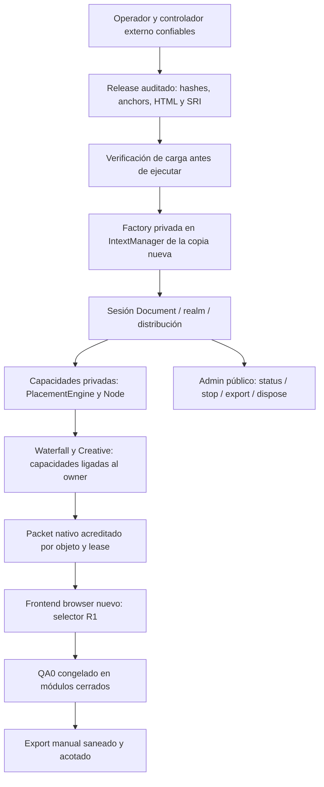

# QA1-B II-B0 — enlace de navegador: arquitectura y fronteras

Estado: **propuesta documental, sin implementación ni ejecución**. II-B1 e II-B2 no están autorizadas. Fecha de referencia: 16/11/2026. Preflight local PASS; dictamen global **PARTIAL** mientras falte revisión documental independiente. No es un PASS de navegador. La [revisión](intext-p14b-qa1b-II-B0-review.md) distingue ambas cosas.

## 1. Entradas comprobadas y alcance

Se leyeron completos los contratos [diseño r1-review-B](intext-p14b-qa1b-acquisition-design.md), [matriz](intext-p14b-qa1b-data-matrix.md) y [plan](intext-p14b-qa1b-test-plan.md); también [revisión II-A](intext-p14b-qa1b-stage2a-review.md), [protocolo](intext-p14b-qa1b-stage2a-browser-protocol.md), resultados y manifiestos vigentes. Sus estados históricos no se reescriben: las autorizaciones posteriores explican la implementación I/II-A, no cambian aquellos documentos.

El [preflight](intext-p14b-qa1b-II-B0-preflight.json) fija Git HEAD, estado limpio inicial, hashes de los **411 archivos existentes**, 386 protegidos de II-A, 22 entradas nuevas II-A y su manifiesto. Incluye las dos entregas de empaquetado existentes, sin volver a empaquetarlas. Se contrastaron 40 referencias del inventario R1 y 36 anchors de métodos, sin generar ni ejecutar copias. El [manifiesto documental](intext-p14b-qa1b-II-B0-integrity.json) compara before/after.

| Entrada | SHA256 de referencia |
|---|---|
| `_gam_kv_.js` | `1cde1ccdc962c07d5833dc9691a3bfe31b7dd74b3e649e89153a240940a06690` |
| `IntextManager.js` | `ba832dc0eb3c0f6e1070a515fac09dd31467e2c7a5a64a18ff4e4f4c063fead8` |
| II-A `gam.qa.js` | `82712fd8317a9de8878c0934e503362bca8a7944c6723209a0e408f0d7cecf78` |
| II-A `manager.qa.js` | `2fa180905972b432a14442bafeaf0d911a71724569b19f7580b03c6c9d2bb7df` |
| Manifiesto II-A | `6eeda91394cde838afe8f3d3176358e1bc9aa7e74492d21e1d7658abf8ea7901` |
| `.sty`, 3940 bytes | `15c72d69032cc0e212b1501cdd78e9da78561b404c65165fe1a6d02efe16b660` |

Los resultados 106/106 II-A, 57/57 I y 108/110 QA0/QA1-A son **evidencia previa conservada**, no suites ejecutadas en II-B0. Los dos FAIL históricos expected 3903 / actual 3940 no se corrigen. La matriz de futuras pruebas y permisos está en [tests](intext-p14b-qa1b-II-B0-test-matrix.md) y [archivos](intext-p14b-qa1b-II-B0-file-matrix.md).

CodeMemory listó el proyecto y reportó el mismo Git HEAD; eso no acredita frescura global del índice. Se consultaron list_projects, search_graph, get_code_snippet, trace_path y search_code. `index_status` fue rechazado por exigir aprobación con política never; no se solicitó permiso ni se reindexó. Sus traces inbound de wait devuelven showDisplay/buildAndPlayVideo, pero omiten activate→W4. Por tanto, el grafo no acredita exhaustividad. Prevalecen los bytes locales y el inventario R1, no el número de aristas. Consultas/resultados seleccionados constan en preflight; no se consultó red, navegador o documentación web.

## 2. Decisión de composición

No se activan ni modifican las copias II-A. El helper léxico global `__qa1b2a_...` es visible como identificador desde otros scripts del mismo realm: que no aparezca en window no lo hace privado. Sustituir su endpoint null por uno real dejaría una entrada invocable. II-B1 necesitaría **otras copias**, otro generador y otra auditoría.

Propuesta preferida: copia clásica nueva, con las mismas clases comerciales y orden de bootstrap, que transporte la capacidad mediante **campos privados de clase y argumentos QA internos**. No envolver todo el core en una IIFE, convertirlo a ESM, exponer un bus global o parchear prototipos. Esos atajos alterarían el alcance de sus clases o permitirían inyección.

La factory se compilaría dentro de un campo estático privado de IntextManager; su tabla Document→sesión sería WeakMap y se inicializaría de forma fallible/protegida antes del primer uso QA. La clase conservaría sus bindings globales comerciales. Varias instancias de Manager del mismo documento/distribución compartirían **un ledger y un presupuesto**. La factory no sería una propiedad pública, variable global léxica ni export de página.

Los puntos internos propuestos son Manager→PlacementEngine/Node al crearlos, Node.initialize→Waterfall y Node.buildAndPlayVideo/Waterfall.setupVideoPreparation→Creative. Pasarían una referencia opaca por un **argumento final con default null**, almacenada solo en un campo privado; no se añadiría una propiedad a config, targeting, DOM, SDK u opciones comerciales compartidas. Name/length de constructores, super y parámetros comerciales se comprobarían expresamente. El argumento QA no se propaga a Video.js/IMA/Prebid/APS/GAM. Si un constructor no permite esto sin alterar semántica, II-B1 queda BLOCKED en ese punto: no se amplía silenciosamente el transform.

Cada tap recuperaría su capacidad dentro de una protección QA. No se llama al guard dentro de un catch QA: sus excepciones deben seguir siendo originales. El retorno de un wrapper conserva la **misma referencia** y la lectura original de eligible. Un receptor falso de método no puede adquirir la capacidad por `.call()` ni producir una excepción QA nueva observable. Las plantillas exactas deberán probar estos casos; este documento no contiene implementación de ellas.

Los callers de wait requieren además un **ticket opaco por invocación**, emitido en el sitio W2/W3/W4 desde esa capacidad privada y pasado como argumento QA final, con default null, al wait original. Un source string que diga vídeo no acredita su caller, ni siquiera sobre un Node real. El ticket vincula propósito, Node, token y owner/lease; no contiene referencias DOM/SDK en su registro. C1 se acredita por el tap privado situado en su expresión concreta. Esto añade un transform explícito de los tres sitios de llamada y de la firma wait, no solo del check común.

El frontend nuevo no importaría `createNativeOffline` como si fuese browser-ready: exige capacidad de build Node y clock sintético; además utiliza crypto/Buffer. Tampoco se amplía la authority sintética de I/I-01. Se crea un perfil `qa1b-native-browser-packet-v1`, distinto de `II-A-offline`, con clock de página y procedencia de release/carga. La proyección sigue siendo **sample v1 / r2** de QA0, sin ampliar validaciones ni reinterpretar su export.

QA0 browser se compondría de los bytes inalterados de `intext-p14b-data.cjs`, `intext-p14b-shadow-evaluator.cjs` y `intext-p14b-shadow-ledger.cjs`, en wrappers CJS estáticos cerrados, sin eval/Function/import dinámico. Un require privado de allowlist resolvería solo esos módulos y `node:buffer`. El shim local expondría exclusivamente Buffer.byteLength para UTF-8, implementado con TextEncoder y probado contra Node, incluidos surrogates. No instalaría Buffer/require global. Una dependencia distinta falla el build. Solo se construye catálogo B0; no se habilitan geometría ni outcomes por incluir los módulos congelados.

No se necesita SHA síncrono por packet: objetos emitidos inmutables, secuencia y leases privados bastan para deduplicar dentro de la autoridad local. Los SHA de release/bytes se verifican fuera del hot path; no se añade await crypto.subtle a un guard. Los cambios de representación/fingerprint del frontend se versionan y se cotejan con los oráculos I/II-A; no se afirma identidad de su schema sintético/offline.

## 3. A — bytes realmente cargados

Cadena de confianza propuesta, verificable antes de una ejecución autorizada:

1. Revisor externo fija un release de entrada: hashes base anteriores, hash padre II-A, hashes de tres módulos QA0 y fuentes nuevas, 36 anchors heredados más cada nuevo anchor de binding, diff, receta de composición, bytes/SHA256 de **cada copia II-B1** y token SRI correspondiente. Los hashes II-B1 todavía no existen: no se inventan ni se reutilizan los II-A.
2. El operador aprueba por un canal externo confiable ese manifiesto y el punto de inclusión HTML. El HTML/loader usa exactamente una distribución, script clásico externo con integrity fijado y los atributos/posición de carga comercial originales. No se introduce un fetch QA, blob/data URL, eval, retry o fallback automático. CORS/CSP/SRI deben funcionar con el despliegue real; incompatibilidad bloquea la prueba, no se relajan políticas.
3. El navegador valida SRI **antes de ejecutar**. SHA declarado dentro del script, URL, sourceURL, script.onload, performance resource timing, un JSON de recibo o el hash del fichero en disco no acreditan por sí mismos el cuerpo servido. Una respuesta de red/caché/Service Worker que no satisfaga SRI no debe ejecutarse. Si falta integrity o no puede probarse su aplicación, el perfil no se inicia.
4. El controlador externo correlaciona carga y ejecución con target/frame/documento/contexto de ejecución, orden, distribución y URL/redirect aprobados. Conserva para auditoría el cuerpo de respuesta usado por esa carga, su cotejo y el evento de ejecución correspondiente. No hace otra petición para obtener un cuerpo posiblemente diferente. Debe distinguir bytes HTTP comprimidos de la representación que SRI verifica; probar UTF-8, BOM, CRLF, compresión, caché y SW. Si esa correlación no es recuperable, resultado BLOCKED. Un hash tras normalizar texto no es evidencia equivalente.
5. Solo bajo esa ruta de carga acreditada la ejecución de la factory privada crea una autoridad de sesión. La correspondencia de sesión pública con el contexto observado se obtiene por el controlador, no aceptando una declaración enviada por la página como credential. Si el controlador no puede acreditar la relación, el export es no acreditado, aunque sus contadores tengan buena forma.

SRI resuelve la igualdad del recurso aplicado por el navegador bajo una inclusión confiable; **no atestigua por sí solo toda la página, ni el origen de una llamada JavaScript posterior**. El código de página tampoco dispone aquí de una prueba infalsificable de su propio recurso. Ejecutar el mismo texto mediante otra ruta no hereda la autorización del release. La precondición externa de carga es parte obligatoria del perfil. No se confunde el secreto/capacidad local con una firma de fuente externa.

No hay autorreferencia de hash: el buildId embebido se deriva de **inputs/receta**, no del hash de la salida que lo contiene. El SHA completo de la copia y SRI se calculan después y viven en el manifiesto/HTML externos. La factory podría capturar en su inicialización de clase los metadatos de document.currentScript para anotarlos, sin retener el elemento ni URL; son datos, no credentials. Ausencia de inclusión clásica/integrity válido deja QA INACTIVE. La aceptación A completa exige además el cotejo externo real de carga/contexto: un dato de currentScript, por sí solo, no demuestra aplicación de SRI. Si el entorno no permite probar esa precondición antes de la prueba y correlacionar la sesión, no se acepta ningún resultado A ni se inicia el perfil. El schema/export diferencia acreditación local de objeto de acreditación externa de fuente, en vez de llamar a ambas verified=true.

Ante mismatch previo a ejecución se aborta la ruta QA: el navegador bloquea la copia completa. No es posible prometer continuidad comercial de ese script que no se ha ejecutado; no se recarga el original automáticamente. Ante fallo QA después de cargar bytes válidos se deshabilita **solo QA**, sin tocar la ejecución comercial ya iniciada. La restauración del punto de inclusión original requiere un documento nuevo y el protocolo de rollback.

## 4. B/C — sesión, privacidad y límite del realm

La unidad de autoridad es Document real + realm de ejecución + distribución + release + sesión efímera. Un ID público aleatorio con crypto.getRandomValues identifica la sesión para correlación; no es un secreto ni una prueba. Falta de esa API se trata como preflight incompatible, sin Math.random, cookies, storage o identificadores comerciales.

La pertenencia a sesión de referencias nativas y de packets emitidos se mantiene en WeakMaps/WeakSets privados. Sus valores son tuplas escalares y celdas revocables, sin DOM/SDK en rings, recibos, resúmenes o maps fuertes. Las tablas de aliases escalares también están acotadas y cargadas al presupuesto. El scalar verified de salida resume comprobaciones; nunca las sustituye. Validar JSON/schema no añade pertenencia. Toda recepción comprueba membership/lease antes de leer campos, deduplicar, avanzar clock o tocar QA0.

Stop/dispose conserva un tombstone débil del Document en la factory: crear otro Manager, root o slot en ese mismo documento no abre una sesión nueva ni recupera admisión. Las tablas/buffers pueden liberarse, pero no ese veto por documento mientras siga vivo. Solo un Document nuevo bajo otra prueba autorizada permite arrancar; no existe admin para borrar el tombstone. Los puertos privados no capturan Node/DOM/SDK en sus closures de registro: remiten a leases/aliases y tablas débiles.

| Cambio | Regla propuesta |
|---|---|
| Reload / documento o realm nuevos | Nueva factory/sesión/clock/origen de secuencia. Nunca trasladar aliases, leases o timestamps mediante storage, postMessage, window.name o una ventana padre. |
| Múltiples slots/managers | Un presupuesto por documento; Node/Manager reales acreditados, mismo ID DOM no une slots. La oportunidad no es un wait ni un creative. |
| SPA observada | Capturar root/placement y navIndex de la ejecución nativa `onNewArticleDetected`/creación scoped; raíz reutilizada + índice nativo nuevo delimita otra navegación. No crear ciclo comercial QA. |
| Cambio ambiguo / índice repetido o reiniciado / root sin frontera | Unknown y gap de continuidad; no inferir identidad por URL, pathname, newsID, selector ni silencio. No crear un contador QA como generación comercial. |
| Solapamiento de artículos | No retirar todas las raíces anteriores por ver una nueva; cada slot/owner se retira en su frontera nativa. Retirar/reinsertar una raíz sin frontera suficiente deja gap. |
| Destrucción nativa, cleanup, invalidación | Revocación de leases afectados; callbacks viejos conservan genealogía y no heredan la del owner actual. Fin de subintento no es terminal de oportunidad. |
| BFCache/freeze/restore | Perfil inicial **no soporta continuidad autónoma**. El controlador debe parar antes de una transición controlada y usar un documento nuevo. Si solo se descubre después, declarar intervalo no acreditado y gap, sin ocultarlo ni promoverlo a A. |

No se añaden pagehide/pageshow/beforeunload, MutationObserver, PerformanceObserver, heartbeat, timer o polling para resolver lo que no observan las fronteras actuales. Sin un callback nativo acreditado o control externo de la transición **no puede garantizarse revocación inmediata al BFCache ni al desconectarse el controlador**. Un salto de clock no prueba por sí solo BFCache. Esta limitación bloquea el perfil autónomo/continuo; el inicial se restringe a documentos frescos y navegación bajo el protocolo autorizado. No se declara cobertura completa por esa restricción.

Las copias de ambas distribuciones no se cargan juntas ni junto al original en un mismo realm: hay nombres de clases globales coincidentes. Las comparaciones usan documentos separados. Iframes/workers tampoco comparten capabilities ni clocks. Si se desconoce qué scripts/class definitions ya se ejecutaron, no se adjunta QA en caliente.

**Admin público permitido:** namespace nuevo y acotado, sin getters comerciales, con status, stop, exportManual y dispose. Nunca activate, resume, ingest, bind, mint, setters de coverage o referencias a la factory/endpoint. Export devuelve copias escalares saneadas; no DOM/SDK/functions. Una colisión de namespace no se sobrescribe: QA queda deshabilitada. Solo se retira una propiedad si su descriptor aún pertenece a esta sesión. No se crean UI/listeners ni descargas/envíos automáticos. El nombre y su coste forman parte del release auditado.

La capacidad privada sí puede pasar entre clases por referencias internas de construcción, pero no aparece en opciones públicas, keys reflectables, retorno, estado exportado ni eventos DOM. El admin puede causar parada/export, no crear un packet válido. Un script de la página que conozca aliases, hashes, versiones, clases o packets de otra sesión no obtiene esa autoridad.

**Límite de confianza:** no es una defensa contra JavaScript hostil con control del mismo realm, debugger, extensiones o bootstrap. Puede interceptar constructores antes del traspaso, cambiar prototipos/intrínsecos o métodos comerciales, producir efectos reales o manipular el admin. No se sellan prototipos comerciales ni se cambia CSP/SDK para aparentar aislamiento. Si ese riesgo forma parte del entorno objetivo, la propuesta es insuficiente y la validación queda BLOCKED; haría falta otra autoridad de instrumentación/realm y nueva revisión. Un hash correcto no elimina ese límite.

## 5. D/E — tiempo, genealogía y taps

Clock propuesto: referencia confiable de performance.now del realm de la sesión, capturada en bootstrap sin mezclar performance de otro frame. `sourceClock=page-monotonic-ms`; timeOrigin solo informa correlación externa, no convierte epoch/HAR en observaciones. Una lectura de tiempo real al observar cada frontera; lecturas adicionales de brackets de coste se identifican como tales y se cargan a CPU. Igualdad de timestamps por resolución reducida es válida; retroceso, excepción, no finito o referencia no confiable → unknown/gap y stop. No clamping, reordenación ni timestamp fabricado.

Cada ejecución real emitida recibe secuencia propia segura; retransmitir conserva eventId/sampleSequence y membresía del objeto. Una retransmisión vigente retenida devuelve recibo sin nuevo ingest. Un packet exportado/clonado o extranjero se rechaza antes del watermark; uno retirado o expulsado no se recrea. Overflow de secuencia detiene QA sin wrap. Las secuencias no reconstruyen periodos sin guard.

Genealogía nativa: documento/raíz/nav/Manager/Node/anchor observado; ciclo después del incremento; fetchGeneration capturada al comenzar startFetch; auction después de la decisión y guard de generación originales; render/activeToken en su asignación; creative y entry en creación/claim/release. Distinguir waterfall propietario aunque coincidan contadores. El fetch pendiente solo se liga al ciclo factual que le corresponde. Un descriptor de preparación no prueba initialWinner; entry.generation no es fetchGeneration. La ruta startAuction sin generación nativa queda raw/unknown/gap, sin token→generation, default 1 o reparación del core.

| Fuente primaria | GAM / Manager, líneas base | Requisitos adicionales |
|---|---|---|
| W2 capacity-or-legacy | 11983 / 10184; guard común 11537 / 9755 | Node/Waterfall/attempt/ciclo/generación/token; owner=null legítimo; no exigir creative inexistente. |
| W3 waitForViewport de build | 12031 / 10232 | Creative nuevo/preparado asignado, token y lease vigentes, antes de render. |
| W4 video-activation | 16698 / 14539 | Creative=this y su token; mantener await y comprobaciones originales. |
| C1 final activate | 16701 / 14542 | Mismo resultado original tras W4, antes de release/createPlayer/requestAds; preservar short circuit y throw. |

Staging débil de los retornos originales de getReadinessViewportState, sin reevaluarlo ni consultar stacks. Su coste incluye resultados no consumidos. W0 no crea quinta muestra. Se captura true **y false** antes de que el consumidor continúe; guard omitido no es false. Una observación ya verdadera no se borra por invalidación posterior, aunque su retransmisión ya retirada sea rechazada.

El check común acepta como propósito primario solo el ticket privado vigente de su invocación, junto al objeto resultado staged y sus leases. Llamar públicamente waitForViewport con el literal W2, un ticket JSON o uno de otra invocación/sesión no puede crear B0/Dc. Un ticket sirve a los checks originales sucesivos de ese mismo wait; cada ejecución mantiene secuencia nueva. Finish nativo retira el permiso para **nuevas emisiones** del wait, sin invalidar el hecho anterior ni su recibo mientras el owner siga vigente. Callback tardío de un wait ya finalizado no se reatribuye. Si un error original impide observar finish, no se inventa un cierre ni se añade finally/microtask: lease y presupuesto limitan la asociación hasta su revocación nativa/QA. Name/length, owner default, argumentos comerciales, promise, orden y excepciones originales deben preservarse; ticket fallido deja observación unknown sin impedir el wait comercial.

W1 Display y C2–C11 no entran como control al ledger B0. W1 puede quedar raw Display; diagnósticos/proximidad/recuperación/reveal/post-player no se transforman en muestras primarias ni en otra población. No se amplía su adquisición para II-B1. Solo fronteras poblacionales legítimas entran por scope=opportunity/control unknown, nunca scope=display en una oportunidad cuyo winner inicial es Video. Las rutas con initialWinner Display/none quedan no primarias; unknown no se sustituye por Video. No hay getters SDK, rect extra, helpers valid/isActive/getElement adicionales ni llamadas hechas solo para observar.

El marcador de entrada a construcción de player excluye futuros B0, **sin probar que se haya creado**: etapa unknown, P desconocido. Su estado por creative no se reinicia para hacer admisible un objeto reutilizado; solo una genealogía nativa nueva acreditada puede delimitar otro intento. P, manager, medio y frame siguen sin ser requisitos B0 ni datos adquiridos en esta subfase.

## 6. F–J — reglas de aceptación y puertas

QA0 es la única autoridad D0/Dv/Dc. Oportunidad=documento/nav/slot/ciclo; no caller/token/creative. Cuatro checks positivos no crean cuatro oportunidades ni cuatro primeras positivas. Inicio perdido no se reconstruye desde winner/guard; inicial desconocido deja Dv pendiente. Primera muestra positiva implica censura izquierda; cierre sin terminal implica derecha. Cancelaciones no fabrican abandoned/complete ni frames.

Siempre constructor con `sourceComplete={D0:false,Dv:false,Dc:false,outcomes:false}`, sin setter ni promoción al cerrar/exportar. Nivel A válido por muestra se separa de B poblacional insuficiente. Todas las tasas exactas value=null/false, firstPassFrame temporal-coverage-not-implemented; export QA0 permanece anidado e inalterado. Cambiar el mecanismo de autoridad no autoriza tasas ni otro perfil completo.

Los 2 MiB compartidos, medición de CPU/layout/GC/heap, latches, export y rollback se especifican en [presupuesto/parada](intext-p14b-qa1b-II-B0-budget-rollback.md). Las pruebas se separan en auditoría estática, harness local, Chrome aislado y, solo con otra autorización, GAM Preview/Fiddler. Ningún resultado sintético de canary/SRI o métodos extraídos acredita que una copia GAM/Manager se sirvió y ejecutó en publicidad.

La [matriz por archivo](intext-p14b-qa1b-II-B0-file-matrix.md) define únicamente permisos **propuestos**, sus invariantes, oráculos, costes y conflictos. No concede permiso para crear esos ficheros ahora. Un archivo existente que necesitara cambio exige otra autorización, no una excepción inferida de este plan.

Pendientes: transporte privado y semántica de constructores bajo wrappers reales; loader externo y SRI/CORS/CSP; clock/intrínsecos confiables; SPA/BFCache y callbacks tardíos; ruta legacy incompleta; presupuesto físico y temporal; revisión documental independiente. Se detiene II-B0 al entregar estos documentos. Nada implementa o activa II-B1, II-B2, III–IV, B runtime/enforce, geometría, outcomes, A3 o C.
