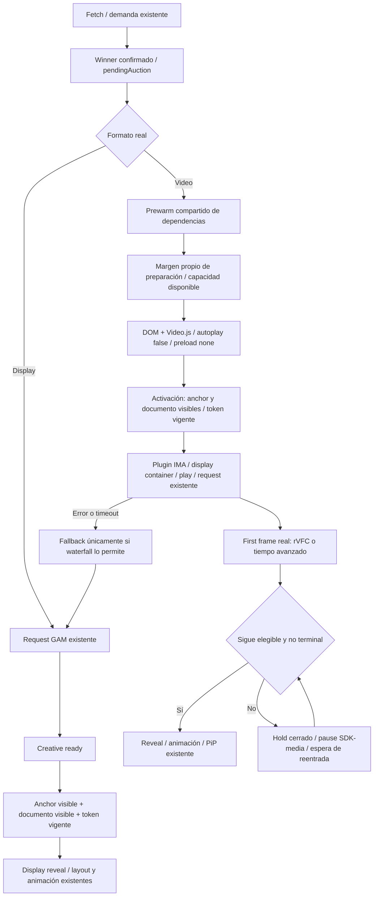

# Intext Predictive Readiness — diagnóstico y diseño

## Auditoría inicial (2026-10-08)

Workspace de referencia: `2026.10.07-p1-ima-preload-first-frame`, baseline real 763/763.
Las distribuciones son `_gam_kv_.js` (bloque Intext) e `IntextManager.js`.
Hay cambios anteriores sin commit: se conservan. CodeMemory encuentra las clases,
pero sus rangos y helpers están desactualizados; el workspace es la autoridad.

Flujo actual: fetch/Prebid → pendingAuction → prewarm de dependencias → render
margin → winner request/TAM/tag → buildAndPlayVideo → viewport 0px del wrapper
Display → dependencias → DOM/Video.js → plugin IMA/play → frame → reveal.
La construcción del player espera visibilidad aunque `autoplay:false` permite
preparar Video.js sin reproducir. La referencia de carga existente usa
telemetryAnchor/paragraph y es más estable que el wrapper cerrado.

Display solicita GAM antes de `showDisplay`; su espera es un gate de apertura,
no de request. Se conserva la petición, targeting, selección y fallback.

## Puntos de modificación

1. Preparación opcional después del winner Video confirmado, con un margen
   propio, ownership de auction/ciclo y capacidad compartida acotada.
2. Separar `prepare()` (dependencias, DOM, Video.js sin preload de contenido)
   de `render()`/activación. Mantener plugin IMA, display container y play en
   activación: no inferir que inicializar el plugin antes sea libre de requests.
3. Gate viewport sobre anchor estable y documento visible, cancelable por
   token/reset/destroy; volver a comprobar después de cada await.
4. Gate de reveal estricto y observación durante request, sin forzar apertura
   cuando la posición se ha superado. No reemplazar el first frame por STARTED.
5. Telemetría separada de preparación, espera, activación y respuesta.

No se atribuyen VAST 303/VPAID 901/media abort al viewport sin evidencia.
No se cambian PSP, GAMExp, WindowArray, random, floors, pujas ni waterfall.

Video.js documenta `autoplay` y `preload` como opciones del player:
https://docs.videojs.com/player
La integración IMA conserva el lifecycle de inicialización y playback existente:
https://github.com/googleads/videojs-ima/blob/v1.11.0/README.md

## Arquitectura implementada



`prepare()` y `render()` comparten sus respectivas Promises por creative.
Preparar no inicializa el plugin IMA, no llama play, no pide VAST y no abre el
wrapper. El dummy source existente es data:; `preload:none` evita cargarlo
durante preparación. El plugin IMA, los settings y la request mantienen el
lifecycle de activación existente. No se modifica consentimiento ni autoplay.

El gate visual usa `getIntextTelemetryElement()` (anchor/paragraph antes que
wrapper). La geometría y el estado del documento se comprueban también después
de awaits y al llegar `player.ready`. Sin IO, el gate usa geometría y listeners
pasivos de scroll/resize, retirados al resolver. Anchor eliminado falla cerrado.

## Configuración y modos

```js
loading: {
  videoPreparation: {
    enabled: true,
    preparationRootMargin: "1000px 0px",
    maxPreparedPlayers: 2,
    preparedMaxAgeMs: 15000
  }
}
```

Los defaults del core son enabled=true, margen vertical de una altura de
viewport **en px**, capacidad 2 y lease 15000ms. No se usa `%` como sinónimo de
altura: IntersectionObserver resuelve porcentajes contra el ancho del root.
El lead de un viewport adelanta trabajo una pantalla sin modificar los márgenes
de subasta/render. La capacidad 2 permite las dos posiciones comunes; se puede
reducir a 1. Son defaults técnicos, sin condición por dominio, número o ID.
Los overrides efectivos de loading por sitio/dispositivo/slot mantienen su
resolución y deep merge actuales. `adaptive` no se implementa en este P1.

El margen configurado no garantiza anticipación: preparar requiere winner Video
confirmado, entrada en la zona y capacidad. El inicio efectivo es el último de
esos hitos. Fetch margin, latencia de subasta y velocidad de scroll pueden hacer
que el winner llegue cuando el anchor ya está visible. Los eventos registran el
margen configurado, distancia real al disparar y edad del winner; winner→prepared
mide preparación/disponibilidad técnica, activation→first-frame mide por separado
el camino publicitario. No se cambian los márgenes de fetch para aparentar mejora.

- display_only: nunca prepara player. Request y presentación Display existentes.
- video_only: prepara y activa vídeo; selección y prohibición de fallback siguen
  perteneciendo al waterfall, no al coordinador de preparación.
- auto: sólo prepara si el ganador real es vídeo. No cambia pujas ni prioridad.
- enabled=false: opt-out de preparación anticipada; se conserva el camino de
  construcción en viewport y la compatibilidad histórica native_started.

Con readiness activo, native_started sin media observable no sustituye un frame
real. El timer histórico de 500ms y su diagnóstico se conservan, pero no revelan
sin confirmación; el timeout existente determina el terminal. Esto es una
diferencia deliberada de seguridad visual frente al modo de compatibilidad.

## Ownership, presupuesto y reentrada

Un ledger estático pequeño guarda una entrada por waterfall/posición. La
prioridad es proximidad y antigüedad en empates; una posición más cercana puede
reemplazar una preparación especulativa más lejana, nunca un ad ya activado.
Cuando hay límites distintos se utiliza el más restrictivo de los participantes.
Salida de zona, documento oculto, configuración incompatible o stale auction
liberan el player; no hay polling ni retry automático de preparación.

El lease especulativo es min(preparedMaxAgeMs, TTL de pendingAuction), si hay TTL
positivo. Sólo existe en STANDBY_UNBOUND. La transferencia síncrona e idempotente
a RENDER_OWNED cancela la lease y retira el recurso del presupuesto standby.
Un timer ya encolado comprueba identidad y estado antes de actuar. Esperar al
usuario no invalida el token ni destruye el player a los 15 segundos.
El presupuesto limita standbys; los renders transferidos (como los anuncios
activados) conservan un recurso individual por ciclo/posición.
Si no hay capacidad para preparar, la construcción de esa posición espera
elegibilidad real y utiliza las dependencias compartidas, sin retrasar otra
subasta ni crear una cola de demanda.

No se añade timeout técnico de activación: navegación, refresh y cancelación
legítima siguen liquidando el render. Tras activar IMA se conserva el timeout
publicitario de 25000ms y sus reglas de fallback. Un no-fill inicial con anchor superado, aún por debajo o con
documento oculto mantiene ambas superficies cerradas y completa el lifecycle;
se conserva el comportamiento de cierre de una superficie previamente abierta.

La preparación permite reentrada mediante un nuevo evento de proximidad o por
el handoff de render. Una request legítimamente iniciada no se duplica al volver.
Antes del reveal, perder elegibilidad intenta pause en AdsManager/media; volver
intenta resume en AdsManager o play del media ya activado si falta esa API.
Media observado como no pausado no necesita otro play. La reanudación comprueba
token, identidad del media, generación de recuperación y terminal; un rechazo
liquida el vídeo por el error real y permite el fallback autorizado. Sin API para
reanudar, el timeout publicitario existente liquida el ciclo. Se mantiene el
timeout original, sin playback invisible indefinido. Tras reveal, playback/PiP
continúan bajo sus reglas anteriores.

Cada espera de viewport tiene ownership. Abort/destroy de vídeo sólo cancela sus
esperas, no una nueva espera Display de recuperación. Nuevo render, invalidación
de callbacks y reset cancelan el ciclo anterior. Cleanup de waterfall invalida
la generación del fetch para impedir que su await resucite pendingAuction.

## Telemetría

Eventos nuevos: video_winner_resolved, video_prepare_triggered/started/ready/failed,
video_activation_eligible/started/deferred/cancelled,
video_viewport_wait_started/resolved, video_missed_viewport,
video_reveal_blocked_outside_viewport, video_ima_request_sent,
video_ads_manager_loaded (sólo si el plugin emite ads-manager),
video_media_abort_observed, display_creative_ready,
display_viewport_wait_started/resolved y display_reveal_eligible.

Los eventos existentes siguen siendo autoridad para first frame, reveal,
slotRenderEnded y apertura real. `display_reveal_eligible` mide elegibilidad,
no afirma una impresión ni una apertura ya ejecutada. Los campos comunes incluyen
slot/ciclo/token, modo, formato, dispositivo observado (null si no disponible),
distancia, ratio del anchor, visibilidad, source/reason y timestamp.

El summary añade winnerToPreparedMs, preparationMs, preparedToEligibleMs,
activationToRequestMs e imaRequestToLoadedMs. Los hitos de preparación se
transportan a activación dentro del mismo ciclo, porque el agrupamiento histórico
por renderToken separa fetch y render. Un hito no observado permanece null.
El abort registra estado media y lifecycle, sin afirmar qué causó el evento.

## Validación real pendiente

No se afirma mejora de viewability o latencia publicitaria sin nuevos dumps.
Comparar control/feature con iguales dispositivo, modo, slot y condiciones de
demanda en Marca, El Mundo y Expansión, desktop y mobile. Prioridad: primer slot
mobile Expansión, seguida de slot posterior Video y combinaciones de formatos.

Capturar: fetch→winner, winner→prepared, prepared→eligible, activation→request IMA,
request IMA→LOADED, LOADED/STARTED→first frame, frame→reveal, error→fallback,
GAM render→Display open, distancia/ratio al reveal, aperturas con anchor superado,
errores por código y timeouts. Comparar medianas y percentiles por slot/modo.
Separar coste técnico, espera de elegibilidad y respuesta de demanda.

Ejercitar fast scroll, reentrada, pestaña oculta/visible, refresh V→D→V,
navegación SPA, anchor retirado y dos vídeos con presupuesto 1/2. Comprobar
requests en red: cero IMA/play durante prepare y una activación por token.
Mantener cero loader inicial y el único «Recuperando anuncio» en fallback.

Riesgos que necesitan browser/SDK real: autoplay mobile, retrasos de main thread,
VPAID sin media observable, disponibilidad de AdsManager.pause/resume y demanda
VAST 303/901. Si SDK/media no exponen pause, se bloquea reveal y sigue vigente el
timeout existente; no se inventa un mecanismo paralelo de IMA ni un retry.
El anchor es una referencia conservadora de oportunidad: un punto ya superado
puede bloquear una apertura aunque un hipotético wrapper alto aún solapase el
viewport. Es intencional para evitar aperturas retrospectivas/CLS y debe medirse.

## Validación local P1 (referencia)

Baseline comprobado: 763/763. Suite final: 832/832, 0 fail, 0 skipped,
0 cancelled. Se añaden 69 regresiones de readiness/paridad. Grupo vídeo,
preload, PiP y animación: 196/196; Floor Authority: 86/86; Prebid/aliases:
85/85; random/runtime: 61/61; APS/TAM: 63/63; GPT/PSP: 17/17.
Los grupos se solapan con la suite completa y no se suman a su total.

Ficheros por grupo (argumentos de `node --test --test-isolation=none`):

| Grupo | Argumentos |
| --- | --- |
| Vídeo/PiP/animación | `tests/intext-predictive-readiness.audit.test.cjs tests/intext-ima-preload-first-frame.audit.test.cjs tests/intext-pip.audit.test.cjs tests/intext-initial-open-animation.audit.test.cjs` |
| Floor Authority | `tests/intext-floor-authority.audit.test.cjs` |
| Prebid/aliases | `tests/intext-prebid-floor.audit.test.cjs tests/intext-prebid-aliases.audit.test.cjs` |
| Random/runtime | `tests/intext-random-runtime.audit.test.cjs` |
| APS/TAM | `tests/intext-aps-display-slot.audit.test.cjs tests/intext-prebid-aps-psp.audit.test.cjs` |
| GPT/PSP | `tests/intext-gpt-psp.audit.test.cjs tests/intext-gpt-controls.audit.test.cjs` |
| Completa | `tests/*.test.cjs` |

Comandos: `node --test --test-isolation=none` con los ficheros de cada grupo,
y `tests/*.test.cjs` para la suite completa. `node --check _gam_kv_.js`,
`node --check IntextManager.js` y `git diff --check` pasan.
El sandbox Windows bloquea los subprocesses Git/Node lanzados desde Node
(`spawnSync EPERM`). Se ejecutan las comprobaciones reales desde PowerShell y
se suministra evidencia sólo a los comandos exactos de auditoría mediante el
preload temporal existente; los checks de sintaxis verifican SHA-256 del input.
No se omiten tests ni se simulan respuestas de otros subprocesses.

Audit contra las copias iniciales de esta iteración: código exterior al bloque
Intext del bundle idéntico byte a byte; resolver de floors, loader de dependencias,
request Display y request Video/TAM intactos en ambas distribuciones.
Los métodos nuevos tienen paridad exacta. No hay commit ni push.

CodeMemory se reindexó en modo full sin artefacto en el repositorio:
17808 nodos y 33764 aristas. La consulta posterior encuentra los helpers actuales
de preparación, activación, viewport y loader en ambas distribuciones.
La memoria no sustituye las pruebas ni el audit contra el workspace.

## Revisión P1.1 (2026-10-08)

Causa bloqueante: la lease de standby se mantenía después de vincular el token y
se renovaba al entregar el creative. Su callback destruía un recurso transferido
e invalidaba el render. `claimVideoPreparation()` hace el handoff síncrono dentro
de `beginVisualRender("render_started")` y es idempotente en startRender/getPrepared.
También transfiere token/guard del creative y desconecta observación de standby.
La lease únicamente puede cancelar la misma entrada STANDBY_UNBOUND sin token.
RENDER_OWNED no tiene esa lease; ACTIVATED sale del ledger y al destruir pasa a
RELEASED. Cleanup explícito marca CANCELLED. No se aumenta TTL ni se añade un
timeout de activación que compita con el lifecycle.

Causa geométrica: el gate anterior sólo comprobaba el eje vertical y autorizaba
un rect de altura cero. Ahora exige dimensiones positivas/finítas, solapamiento
en ambos ejes, documento visible y anchor renderizado; se comprueba display,
visibility y opacity del anchor/ancestros. Un anchor sin dimensiones falla
cerrado. La ratio es la del anchor, no viewability medida del anuncio.

Causa de recuperación: se pausaba media, pero sólo se intentaba resume del
manager. Las APIs ausentes no dejaban un camino para reanudar media pausada.
Ahora se distingue recuperación vía manager, media activado o media observado
ya reproduciendo. Un intento asíncrono queda ligado a generación/token/media;
terminal/destroy/abort invalidan su continuación. Sin API sigue vigente el
timeout publicitario; rechazo real de reanudación conserva el fallback permitido.

Display winner registra `intext_winner_resolved`, sin prefijo de vídeo.
Diagnósticos: `video_standby_expired`,
`video_preparation_ownership_transferred`, `video_activation_pending`,
`video_activation_cancelled`, `video_recovery_started/resumed/unavailable/failed`,
`video_advertising_timeout`. Summary añade `activationToFirstFrameMs` a los
hitos existentes y conserva null cuando falta un timestamp observado.

Baseline real P1.1: 832/832. Suite final: 887/887, 0 fail/skipped/cancelled.
Grupo vídeo/preload/PiP/animación: 250/250; Floor: 86/86; Prebid/aliases: 85/85;
random/runtime: 61/61; APS/TAM: 63/63; GPT/PSP: 17/17.
Se mantienen los mismos comandos y el procedimiento de evidencia externa.
No hay script de lint/ESLint configurado en este workspace; la suite completa
incluye los audits disponibles de scope, arquitectura y seguridad/redacción.
Ambas distribuciones pasan node --check y git diff --check.

Regresiones: 20/45s esperando viewport, lease original ya encolada durante
startRender→build, expiración de standby sin propietario, presupuesto liberado
para otro slot y protección de activados, destrucción idempotente, refresh/
navegación, error tras 20s con/sin fallback, geometría cero/horizontal/oculta/
parcial, reentrada del documento, APIs de manager ausentes, media.play rechazado,
terminal durante resume asíncrono, winner Display y winner tardío.
Media observado ended/error no se reinicia durante reentrada.
Una prueba del summary usa timestamps controlados y separa winner→prepared de
activation→first-frame; no se afirma beneficio de rendimiento real sin dumps.

Scope contra el inicio P1.1: resolver de floors, loader, request Display,
request Video/TAM, selección/fallback requestWinner y scheduler sin cambios.
Exterior del bloque Intext del bundle idéntico byte a byte. Se mantienen versión,
dependencias y timeouts publicitarios. No hay commit ni push.

CodeMemory P1.1: primer reindex full devolvió degraded por fallo de integridad;
se reconstruyó y volvió a status indexed (17808 nodos / 33764 aristas), sin
artefacto en el repositorio. La consulta posterior sigue sin encontrar el helper
nuevo claimVideoPreparation, aunque existe y se ejecuta en ambas distribuciones.
El grafo estructural permanece incompleto para esta revisión; no se utiliza para
afirmar paridad, scope o validación. Código actual, diff y tests son la autoridad.

## Corrección P1.2: recuperación coordinada IMA/media (2026-10-09)

El ownership de preparación y sus leases de P1.1 permanecen intactos. Esta
corrección afecta únicamente a `IntextVideoCreative.observeActivationEligibility()`
y a sus puntos de integración dentro de `requestAds()` en ambas distribuciones.
Se conserva la versión `2026.10.07-p1-ima-preload-first-frame`.

Causa raíz: al salir se ejecutaban tanto `AdsManager.pause()` como `media.pause()`.
Al volver, un retorno `undefined` de `AdsManager.resume()` se interpretaba como
recuperación efectiva, aunque el medio independiente continuase pausado. La API
IMA declara pause/resume como operaciones void; no aportan prueba de reproducción.
Referencia: [AdsManager](https://developers.google.com/interactive-media-ads/docs/sdks/html5/client-side/reference/interface/google.ima.AdsManager)
y [eventos IMA](https://developers.google.com/interactive-media-ads/docs/sdks/html5/client-side/reference/namespace/google.ima.AdEvent).

Política final:

- Cuando el manager ofrece ambas operaciones, IMA controla pausa y reanudación;
  no se pausa ni reproduce su medio por una segunda ruta independiente.
- Sin control IMA completo, o si su pause falla, se utiliza el medio disponible.
  Un medio pausado directamente conserva ese ownership durante las reentradas
  previas al reveal, aunque aparezca después un manager independiente.
- Si desaparece el manager propietario, la recuperación puede transferirse al
  medio. El diagnóstico incluye `pauseOwner` y `ads-manager-unavailable`.
- `resume()` sólo registra la llamada a API. Confirmación exige `RESUMED` de IMA
  compatible con el medio observado, `playing`, avance de tiempo con el medio
  despausado, o resolución de `media.play()` con el medio realmente despausado.
  Un medio observado pausado/ended/error nunca queda confirmado por RESUMED.
- La confirmación de recuperación no sustituye la prueba estricta de first frame.
  Un frame previamente confirmado tampoco permite revelar un medio aún pausado.
  Se conservan la fuente rVFC, su ownership y las reglas de animación/PiP.
- Excepciones/rechazos reales y media ended/error liquidan la espera como fallo
  de recuperación. El waterfall existente decide exclusivamente si permite
  Display. Ausencia de API/señal sigue acotada por el timeout publicitario de
  25000 ms; no se amplía ni añade una request, reproducción o impresión.

Cada intento queda ligado a epoch, token, identidad de media y manager cuando
corresponde. Una nueva salida invalida el intento pendiente y permite otro al
reentrar. Si termina tarde un `media.play()` cancelado mientras sigue fuera,
se vuelve a pausar únicamente el medio que continúa siendo de ownership directo.
Terminal, abort, destroy y token obsoleto impiden confirmar/revelar desde callbacks
anteriores. Cleanup retira observers/listeners y referencias de recuperación.
El playback/PiP de un anuncio ya revelado sigue bajo las reglas existentes.

Telemetría: `video_recovery_requested`, `video_recovery_api_called`,
`video_recovery_confirmed`, `video_recovery_failed`, `video_recovery_cancelled`,
`video_recovery_control_unavailable` y el diagnóstico existente de API ausente.
`video_recovery_resumed` queda como compatibilidad sólo tras confirmación real.

IntersectionObserver no notifica cambios de opacity sin nueva geometría. Se
revalida en eventos existentes de reproducción/visibilidad, scroll/resize pasivos,
y transitionend/animationend del anchor o sus ancestros, sin polling ni
MutationObserver. Una mutación instantánea de estilo sin ninguno de esos eventos
se comprobará en la siguiente señal; no se afirma detección inmediata universal.

Validación P1.2: baseline real 887/887; suite final 925/925. Se añaden 38 pruebas
(19 por distribución) sobre SDK/media independientes, retorno void, confirmación
diferida, ownership directo, desaparición de manager, rechazo y fallback permitido/
prohibido, salidas repetidas, Promise tardía, token/navegación/refresh/terminal,
reemplazo de media, frame ya confirmado pero pausado y opacity sin intersección.
Se actualizan los mocks anteriores para representar señales reales del SDK,
en lugar de asumir que su retorno void implica recuperación.

Grupo vídeo/preload/PiP/animación: 288/288; Floor Authority: 86/86;
Prebid/aliases: 85/85; random/runtime: 61/61; APS/TAM: 63/63; GPT/PSP: 17/17.
Todos con 0 fail/skipped/cancelled, usando los mismos comandos documentados arriba.
Ambas distribuciones pasan `node --check`; `git diff --check` pasa. La suite
incluye los audits disponibles de arquitectura/scope/seguridad; no hay lint
independiente configurado. Para subprocesses bloqueados por el sandbox se mantiene
el procedimiento previo de evidencia externa PowerShell verificada mediante SHA-256.

Audit contra las copias iniciales P1.2: al sustituir exclusivamente los dos
métodos revisados por sus versiones iniciales, todo el código productivo restante
coincide. Exterior del bloque Intext del bundle idéntico byte a byte. Leases,
handoff, scheduler, Floor Authority, GAMExp, WindowArray, RandomStrategy, PSP,
Prebid/APS/TAM, precios, waterfall y Display no reciben cambios nuevos.
Paridad de los métodos nuevos comprobada por tests. Sin commit ni push.

Riesgo residual: un SDK que no emita una señal fiable o no recupere la reproducción
no se declara recuperado artificialmente; permanece sujeto al timeout vigente y
al fallback autorizado. Los tests aislados no demuestran comportamiento de demanda
real ni una mejora de viewability, que requieren validación posterior independiente.

CodeMemory P1.2: reindex full final con `persistence:false`, status `indexed`,
17818 nodos y 33795 aristas, sin artefacto añadido al workspace. La búsqueda
posterior encuentra `claimVideoPreparation` en ambas distribuciones y el método
de recuperación actual de 130 líneas con fingerprints iguales. `get_code_snippet`
vuelve a entregar el código actual de recuperación, a diferencia del grafo antiguo
consultado inicialmente. Código, tests y diff siguen siendo la autoridad del audit.

## Corrección puntual P1.2a: autoridad ligada al medio pausado

Hallazgos reproducidos: el owner directo se creaba incluso con media null o pausa
fallida, y la selección de recuperación aceptaba cualquier elemento con play(),
permitiendo transferir implícitamente el permiso de A a B.

`pauseMedia()` sólo registra `ad-media` después de llamar realmente a pause(),
sin excepción, sobre el mismo elemento todavía observado y con paused=true.
Sin elemento, sin API, con excepción o sin efecto observable, no existe permiso
directo. Repetir una pausa directa también elimina el permiso previo si falla.

La recuperación directa requiere identidad estricta `owner.media === media`.
Un reemplazo invalida ese ownership y registra
`video_recovery_ownership_invalidated` con reason=media-replaced. El medio nuevo
se recupera mediante el AdsManager vigente con ambas APIs, si existe; no hereda
play() del anterior. Una llamada play() tampoco crea retroactivamente un owner
que afirme que se pausó directamente ese elemento.

Se conserva el handoff legítimo P1.2 cuando desaparece el control SDK y se trata
exactamente del mismo medio que estaba identificado al pausar mediante IMA,
todavía pausado. El handoff no permite recuperar elementos distintos ni un medio
que apareció después de una pausa IMA sin media observable.

Un AdsManager reemplazado cancela y reevalúa su intento pendiente, con diagnóstico
ads-manager-replaced. El mismo A efectivamente pausado directamente mantiene su
autoridad independiente aunque aparezca un manager. Siguen vigentes token, epoch,
identidad de media/manager, terminal y viewport; callbacks tardíos de A no confirman
ni revelan B. Repausar una Promise cancelada exige también identidad del owner.

Validación: baseline real 925/925; 44 regresiones nuevas (11 escenarios por slot,
dos slots, ambas distribuciones); grupo vídeo/preload/PiP/animación 332/332;
suite completa 969/969. Todos con 0 fail/skipped/cancelled. Los escenarios incluyen
ausencia inicial de media/SDK, sustitución A/B con y sin SDK, reemplazo de manager
pendiente, mismo A, pausa que lanza o no tiene efecto, API de recuperación ausente,
eventos/Promise/rVFC tardíos, y error de recuperación con fallback auto permitido
o video_only prohibido. Se comprueba una sola inicialización IMA/player.play por
anuncio, sin nueva petición publicitaria en la recuperación.

Scope byte a byte contra el inicio P1.2a: único método productivo cambiado,
`observeActivationEligibility()`, idéntico en ambas distribuciones. Todo el código
restante, incluido requestAds(), first-frame, reveal, PiP, animaciones, leases,
handoff de preparación, scheduler, Floor Authority, GAMExp, WindowArray, PSP,
Prebid/APS/TAM, sentinels/blanks, random, timeouts y waterfall, coincide exactamente.
Versión conservada. Ambas distribuciones pasan node --check y git diff --check.
El diff productivo incremental se entrega en `docs/intext-p12a-ownership.patch`.
Se mantiene el procedimiento de evidencia externa SHA-256 para subprocesses
restringidos por el sandbox, sin omitir pruebas. No hay commit ni push.

Sin autoridad/API válida, se espera una señal real o el timeout publicitario
existente de 25s y el fallback autorizado; no se inventa un permiso de reproducción.

Grupos complementarios P1.2a: Floor Authority 86/86; Prebid/aliases 85/85;
random/runtime 61/61; APS/TAM 63/63; GPT/PSP 17/17, sin omitidos ni fallos.
El patch incremental pasa `git apply --reverse --check` contra el workspace
actual (comprobación read-only, sin aplicar ni revertir cambios).

CodeMemory P1.2a se consultó antes del cambio y se reindexó al terminar:
status indexed, 17820 nodos / 33796 aristas, persistence=false. La comprobación
posterior muestra que el snippet lee las nuevas validaciones, pero los metadatos
estructurales del método conservan extensión/fingerprint de P1.2; siguen
desactualizados pese al status del index. No se utilizan para afirmar paridad
o scope: esas garantías proceden del workspace, audit byte a byte y tests reales.

## P1.2b — Ownership atribuible y recuperación sin reintentos redundantes

La causa del ownership incorrecto era comprobar únicamente paused=true después
de pause(). Eso también autorizaba play() sobre un medio previamente pausado por
otra autoridad. Ahora se captura el estado previo: un owner directo nuevo exige
paused=false antes y paused=true después de nuestra llamada, sin excepción y con
la misma identidad. Un owner directo previamente válido se conserva para ese
mismo elemento. Un medio previamente pausado sin owner propio no adquiere permiso;
si aparece un AdsManager con pause/resume, se respeta su control.

Las salidas repetidas sin recursos reiniciaban la pausa porque no había owner.
Ahora se guarda el estado de control después de nuestra intervención: identidad
del medio y manager, referencias de sus APIs y estado paused. Scroll/resize sin
cambios no incrementan epoch ni repiten pause(). Cambios reales vuelven a evaluar
el control. Una recuperación pendiente sin API también detecta APIs que aparecen
en el mismo objeto y registra recovery-api-changed antes de reevaluar. No se añade
polling, observer, timer ni un nuevo timeout. Cleanup elimina el snapshot local.

48 regresiones nuevas: 12 escenarios por slot, dos slots y ambas distribuciones.
Cubren medio previamente pausado con SDK posterior, transición efectiva y owner
persistente, pausa con excepción/sin efecto, comprobaciones sin recursos, SDK y
APIs tardías, recuperación pendiente reevaluada, sustitución A/B y las políticas
auto/video_only ante error. Se mantienen pruebas de señal real, una única apertura
y ausencia de nuevas inicializaciones/peticiones publicitarias.

El diff productivo incremental está en `docs/intext-p12b-ownership.patch`.
Scope comparado byte a byte con el workspace al inicio P1.2b: únicamente cambia
observeActivationEligibility(), idéntico en ambas distribuciones; todos los bytes
restantes permanecen iguales. Se conserva la versión
2026.10.07-p1-ima-preload-first-frame. No hay commit ni push.

Validación P1.2b: baseline real 969/969; vídeo/preload/PiP/animación 380/380;
Floor Authority 86/86; Prebid audit/aliases 85/85; random/runtime 61/61;
APS/TAM 63/63; GPT/PSP 17/17; suite completa 1017/1017. Cero fail, skipped,
cancelled o todo. node --check de ambos bundles y git diff --check: PASS.
El patch pasa git apply --reverse --check (solo lectura).

Comandos: node --test --test-isolation=none seguido de los ficheros del grupo;
grupo afectado: intext-predictive-readiness.audit.test.cjs,
intext-ima-preload-first-frame.audit.test.cjs, intext-pip.audit.test.cjs,
intext-initial-open-animation.audit.test.cjs. Suite completa: tests/*.test.cjs.
Los grupos restantes utilizan los mismos ficheros/comandos registrados en P1.2a.
Se mantiene el preload temporal de evidencia externa para los execFileSync
restringidos por sandbox: únicamente git rev-parse, git diff --name-only y
node --check ejecutados realmente desde PowerShell, con SHA-256 actual de ambos
inputs. No se omiten tests ni se sustituye ninguna otra operación. No existe
lint independiente configurado; se ejecutan los checks de arquitectura y
diagnóstico/seguridad disponibles dentro de la suite completa.

CodeMemory P1.2b: consultado antes y reindexado al finalizar, status=indexed,
17822 nodos / 33798 aristas, persistence=false. El snippet incorpora wasPaused,
lastPauseState y recovery-api-changed, pero la extensión/fingerprint estructural
sigue anclada en P1.2 (130 líneas), truncando la lectura. Este desfase de memoria
se conserva explícitamente como limitación; la fuente de verdad y la comprobación
de scope son el workspace y la comparación byte a byte, no el grafo.

Riesgo operativo conservado: si no hay API/autoridad válida ni señal real de
recuperación, no se inventa reproducción. El ciclo sigue limitado por los 25s
publicitarios actuales y por el fallback autorizado. No se validan aquí cambios
de viewability real ni tráfico de demanda en navegador.
